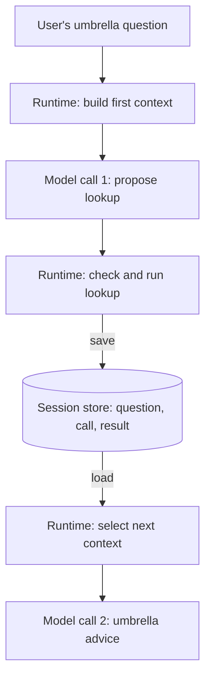

🗓️ 17102026 1526

# memory_and_state

A model only sees what the runtime puts in each request. What the runtime saves, and what it loads back, decides which earlier results shape the next call. Read [[agent_runtime]] first.

## Terms

| Term | Definition | Source |
|---|---|---|
| **Token** | The smallest unit of text a model reads or writes, such as a word, word piece, or punctuation mark. | [Google glossary](https://developers.google.com/machine-learning/glossary#token) |
| **Context** | The full set of tokens the model receives for one request: instructions, history, tool results, and retrieved data. | [Context engineering](https://www.anthropic.com/engineering/effective-context-engineering-for-ai-agents) |
| **Context window** | All the text a model can reference while generating a response, including the response itself. Its size is a fixed token limit. | [Context windows](https://platform.claude.com/docs/en/build-with-claude/context-windows) |
| **Agentic memory** | Notes the agent writes to storage outside the context window and reads back later, so information outlives one context. | [Context engineering](https://www.anthropic.com/engineering/effective-context-engineering-for-ai-agents) |

## Information carried between calls

| Information | Purpose | Example |
|---|---|---|
| Instructions and tool schemas | Define behavior and available operations | Weather tool accepts a city |
| Conversation history | Preserve the request and earlier responses | User asks about Singapore |
| Tool proposals and results | Connect actions to observed outcomes | Lookup request and weather data |
| Workflow progress | Track completed and pending work | Lookup done; answer pending |
| Retrieved memory | Reuse relevant information from earlier work | User prefers Celsius |

Not every request carries all five. The runtime can store more than it sends.

## Two calls in one weather task

Example: a custom runtime with a session store. An SDK does this bookkeeping for you.

Saving is half the handoff; the runtime must also load the result into call 2. As history grows, the runtime summarizes, drops, or retrieves older content.

Who assembles the history depends on the setup:

- Direct API: your code.
- Agent SDK: the SDK.
- Managed service: the service stores it; you pass a reference.

## Storage ownership and lifetime

**State** records current progress. **Memory** keeps information for later reuse. Storage location doesn't decide which is which: a database-backed session is still state, and a local file can hold memory.

| Scope | Possible storage | Owner | Survival |
|---|---|---|---|
| Active session state | Objects in process memory | Application runtime | Ends unless saved before process exit |
| Resumable session | Files or database records | Application or SDK | Depends on storage durability and retention |
| Managed session | Service-managed storage | Agent service | Depends on service guarantees |
| Reusable memory | Files, database, or retrieval index | Application or memory service | Until updated or removed |

Claude Agent SDK saves session transcripts to disk by default. To resume on another machine, make the transcripts available there; the session ID only points to them.

## Selecting future context

- Saving a preference doesn't put it in the next call. Retrieve it deliberately.
- Carrying history forward doesn't retrain the model.
- Keep only information that changes future decisions.
- Check freshness and access rights before reuse.

See [[agent_patterns/index]] when several agents share state.

## References

- [Effective context engineering for AI agents](https://www.anthropic.com/engineering/effective-context-engineering-for-ai-agents)
- [Claude Agent SDK sessions and persistence](https://code.claude.com/docs/en/agent-sdk/sessions)
- [Managed agent sessions](https://platform.claude.com/docs/en/managed-agents/sessions)
- [Tool results in subsequent model calls](https://platform.claude.com/docs/en/agents-and-tools/tool-use/overview)
