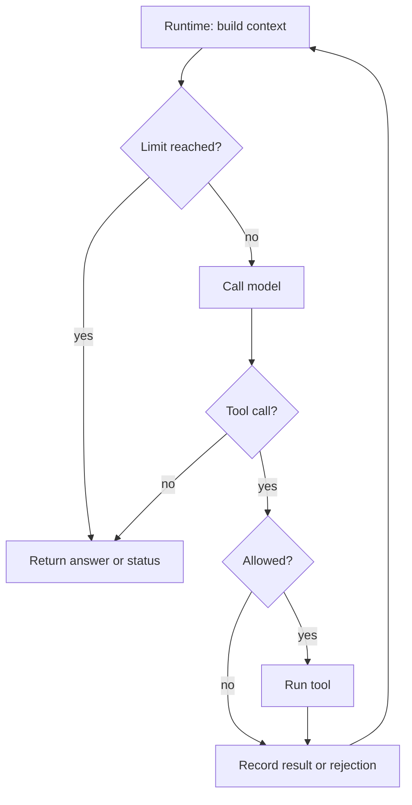

🗓️ 17102026 1526

# agent_runtime

An **agent runtime** coordinates model calls, tools, and state so a task can continue across many steps. Read [[llm_tool_use]] first for a single model–tool exchange.

## Terms

| Term | Definition | Source |
|---|---|---|
| **Agent** | A system where an LLM decides its own steps and tool use, instead of following a fixed code path. | [Anthropic](https://www.anthropic.com/engineering/building-effective-agents) |
| **Agent loop** | The cycle where the model reads its context, calls tools, receives their results, and repeats until the task is done. | [Agent loop](https://code.claude.com/docs/en/agent-sdk/agent-loop) |
| **Turn** | One round trip in the loop: the model's output, the tools it calls, and the results fed back. Other runtimes may count turns differently. | [Agent loop](https://code.claude.com/docs/en/agent-sdk/agent-loop) |
| **Session** | The conversation history the SDK accumulates as the agent works: prompts, tool calls, tool results, and responses. | [Sessions](https://code.claude.com/docs/en/agent-sdk/sessions) |

## One task, repeated model calls

Simplified to one tool call per turn; real runtimes can run several.

- Approval can pause the loop.
- Errors and limits can end it before a final answer.

[[agent_memory_and_state]] traces the context passed between two calls.

## Runtime location and model location

Where the loop runs and where inference runs are separate choices.

| Setup | Where the loop runs | Where inference runs |
|---|---|---|
| Custom loop calling a hosted model | Your application process | Model provider |
| Agent SDK calling a hosted model | A process you operate | Model provider |
| Managed agent service | Service-operated runtime | Configured model service |
| Local runtime and local model | Your machine or infrastructure | Local model server |

[[claude_agent_sdk]] runs in a process you operate. Using a provider's SDK doesn't move your runtime to the provider. Managed services host the loop and can run tools elsewhere.

## Integration points

- An [LLM gateway](gateway/gateway.md) routes the runtime's model requests.
- [MCP](mcp/mcp.md) connects the runtime to external tool servers.
- A simple runtime needs neither: it calls the model and local functions directly.

Once the single loop is clear, see [[agentic_design_patterns]] for multi-step and multi-agent designs.

## References

- [How the agent loop works](https://code.claude.com/docs/en/agent-sdk/agent-loop)
- [Agent SDK deployment choices](https://code.claude.com/docs/en/agent-sdk/overview#compare-the-agent-sdk-to-other-claude-tools)
- [Hosting the Agent SDK](https://code.claude.com/docs/en/agent-sdk/hosting)
- [Client and server tool execution](https://platform.claude.com/docs/en/agents-and-tools/tool-use/overview)
