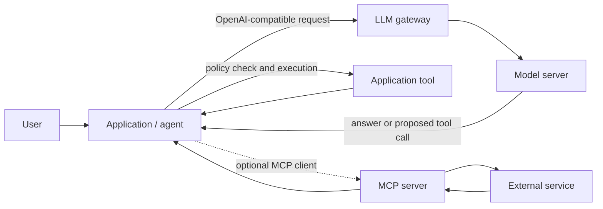

🗓️ 11102026 1520

# ai_overview

AI applications become useful when a language model can use context and act through controlled capabilities. This collection explains the layers around that idea, not how models are trained.

The notes use current standards and vendor documentation for technical guidance. Protocol and product behavior can change; check the linked source pages when applying a detail to a system.

## Start here

An AI application has four separate jobs:

- **Model** — turns a request and context into a response or a proposed tool call.
- **Application** — supplies context, runs tools, and enforces permissions.
- **Workflow** — decides whether one pass is enough or work needs multiple steps.
- **Integration** — connects the application to external systems such as files, databases, and APIs.

The model can propose an action. The application must decide whether to allow and execute it. [[llm_tool_use]] explains this boundary.

## Two learning paths

### Connect a model

- Start with [LLM gateways](gateway/index.md) to understand routing, aliases, and trust boundaries.
- Follow [the request path](gateway/request_routing.md) from an application client to a model server.
- Read [gateway operations](gateway/gateway_operations.md) for configuration, credentials, deployment, and open decisions.

### Build an agent

- Start with [[llm_tool_use]].
- Read [[agentic_design_patterns]] to choose a workflow.
- Read [[agent_memory_and_state]] only when work must survive more than one model call.
- Use [[claude_agent_sdk]] when an SDK fits the workflow, or [[building_with_claude]] to compare implementation choices.

### Connect external systems

- Start with the [MCP overview](mcp/index.md).
- Read [MCP architecture](mcp/mcp_architecture.md) and [transports](mcp/mcp_transports.md).
- Read [[mcp_authorization]] only when a remote server needs user-authorized access.
- Read [[custom_mcp_servers]] when an existing server cannot safely expose your system.
- Follow [connector registration](mcp/connector_registration_flow.md) and [tool invocation](mcp/tool_invocation_flow.md) to see how MCP fits into an application.

## How the ideas fit

**MCP is an integration standard, not an agent framework.** It tells an application how to discover and communicate with a capability provider. It does not decide what the model should do or grant permission for an action.

The gateway routes model requests. The application still owns conversation state, authorization, tool execution, and user approval. A model response containing a tool call is only a proposal; the application decides whether that call can run.

## References

- [[llm_tool_use]]
- [[agentic_design_patterns]]
- [MCP overview](mcp/index.md)
- [What is MCP?](https://modelcontextprotocol.io/docs/getting-started/intro)
