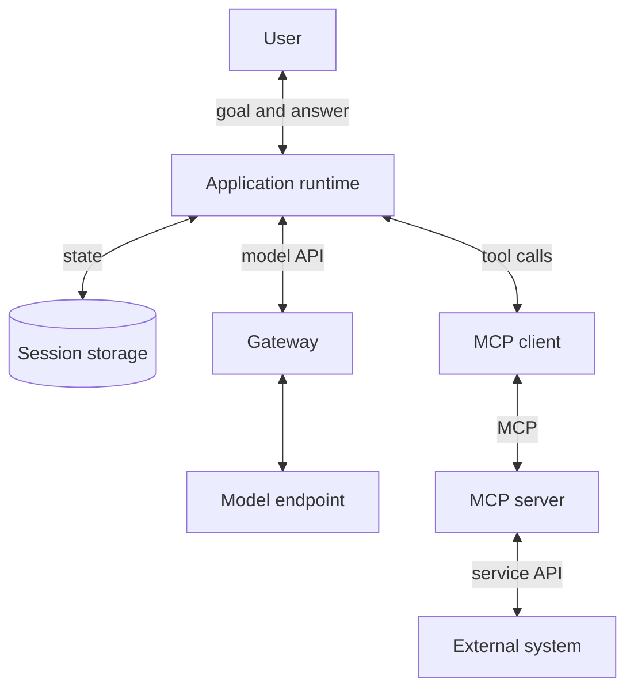

🗓️ 17102026 1526

# ai_overview

An **AI application** pairs a model with context and controlled tools. This note follows one request through each part. Use [[glossary]] to find any term's home note.

## Terms

| Term | Definition | Source |
|---|---|---|
| **Large language model (LLM)** | A language model with a very large number of parameters, trained on large amounts of text to understand and generate it. | [Google glossary](https://developers.google.com/machine-learning/glossary#large-language-model) |
| **Inference** | Running a trained model on new input to produce an output, such as a response. | [Google glossary](https://developers.google.com/machine-learning/glossary#inference) |
| **Application programming interface (API)** | A defined set of operations one program exposes so other programs can use its features or data. | [MDN](https://developer.mozilla.org/en-US/docs/Glossary/API) |
| **Software development kit (SDK)** | A packaged set of libraries and tools for building software on a specific platform or service. | [AWS](https://aws.amazon.com/what-is/sdk/) |

## How the parts connect

The gateway and MCP connection are optional.

- Model requests go through the gateway to the provider's model endpoint.
- Tool calls go through the MCP client to external systems.
- The application owns permissions and conversation state.
- These parts can run on one machine.

## Reading paths

### Build an agent

1. [[llm_tool_use]]: how a model requests a tool.
2. [[agent_runtime]]: the loop that repeats model calls.
3. [[agent_memory_and_state]]: what carries between calls.
4. [[agentic_design_patterns]]: when to add steps or agents.

Compare build options in [[building_with_claude]], or use [[claude_agent_sdk]] for a ready-made runtime.

### Connect external systems

1. [MCP overview](mcp/mcp.md): what MCP standardizes.
2. [[architecture]]: hosts, clients, and servers.
3. [[transports]]: how messages travel.
4. [[connector_registration_flow]]: discovery to approved tools.
5. [[tool_invocation_flow]]: one call through execution.

Read [[authorization]] for protected remote servers, or [[custom_servers]] before building one.

### Route model requests

1. [LLM gateways](gateway/gateway.md): aliases and routing.
2. [[request_routing]]: both network hops of a request.
3. [[operations]]: configuration and verification.

## References

- [MCP architecture, 2026-07-28](https://modelcontextprotocol.io/docs/2026-07-28/learn/architecture)
- [How the agent loop works](https://code.claude.com/docs/en/agent-sdk/agent-loop)
- [Effective context engineering for AI agents](https://www.anthropic.com/engineering/effective-context-engineering-for-ai-agents)
- [LiteLLM request lifecycle](https://docs.litellm.ai/docs/proxy/architecture)
