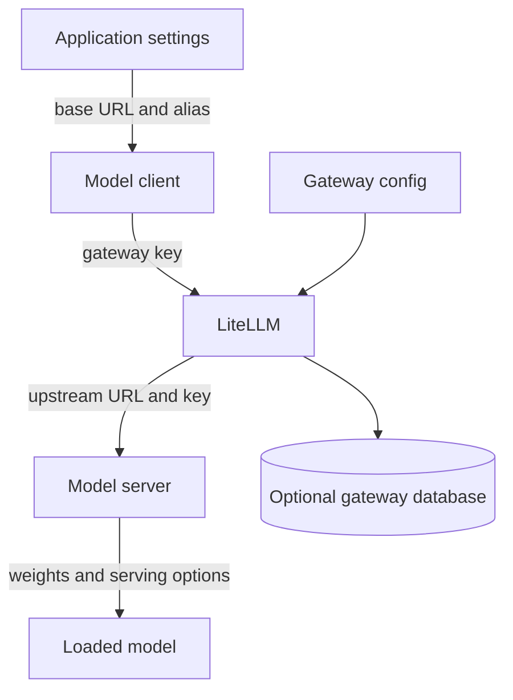

🗓️ 11102026 1520

# llm_gateway_operations

Running a gateway safely means managing its configuration, upstream connectivity, credentials, and failure signals as infrastructure.

## Configuration path

Separate credentials by hop and grant each process only the secrets it needs. Keep production secrets in the deployment secret store or CI variables; do not bake them into images, commit them, or pass them through model context. Use TLS or a private network between separately hosted services.

## Local and production are different topologies

For local development, the gateway may run in a container while the model server runs on the developer machine. The container needs a host-reachable address; `localhost` inside the container points back to the container itself.

In production, place the gateway and backend on a private network where possible. A remote model server needs authenticated, protected connectivity. A healthy gateway process or health endpoint only proves that the process responds; make a model request to verify upstream inference.

Deploy the gateway and model server as separate components when their scaling or release cycles differ. Build and pin the gateway image, deploy it through the chosen platform, then separately deploy the model server and establish protected upstream connectivity.

| Topology | What it teaches |
|---|---|
| Local development | Container-to-host networking differs from `localhost`. |
| Gateway deployment | Gateway release does not deploy model weights. |
| Remote model server | Serving has its own host, key, and lifecycle. |
| Hosted gateway platform | Confirm private networking and upstream reachability. |

## Operational checks

- Pin and review gateway and model-server image versions.
- Use scoped application credentials instead of admin keys.
- Verify startup, gateway health, upstream inference, and tool-call parsing separately.
- Set request deadlines and bounded retries appropriate to the operation.
- Decide whether prompt, response, and usage data may be retained.
- Monitor latency, failures, capacity, and usage without logging secrets.

Retries can duplicate a request or a downstream side effect if a caller repeats the whole agent turn. A model inference retry and a tool execution retry have different safety properties.

## Decisions that depend on the application

- Choose a model host, location, and protected network path.
- Evaluate model quality, tool-call behavior, latency, and capacity.
- Choose scoped application credentials and gateway usage limits.
- Decide what prompts, responses, and usage data may persist.
- Set alerting and ownership for outages and upgrades.

For MCP connectors, separately define ownership, refresh policy, authorization, approval, and write retry behavior.

## References

- [LiteLLM production deployment](https://docs.litellm.ai/docs/proxy/deploy)
- [LiteLLM production best practices](https://docs.litellm.ai/docs/proxy/prod)
- [LiteLLM virtual keys](https://docs.litellm.ai/docs/proxy/virtual_keys)
- [LiteLLM OWASP LLM risks mapping](https://docs.litellm.ai/docs/proxy/security_owasp_llm_top10)
- [LiteLLM Docker image security](https://docs.litellm.ai/docs/proxy/docker_image_security)
- [vLLM OpenAI-compatible server](https://docs.vllm.ai/en/stable/serving/online_serving/openai_compatible_server/)
