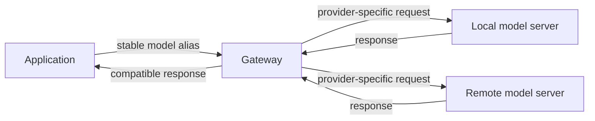

🗓️ 11102026 1520

# llm_gateway

An **LLM gateway** gives an application one managed endpoint for model requests. It can route a stable model name to different providers or serving systems while the application keeps using the same request interface.

## Mental model

The gateway translates and routes model traffic. It is a separate trust boundary because it receives prompts and credentials for upstream providers. It does not replace the application’s authorization or execute application tools merely because a model requests them.

## What the gateway can own

- Provider adapters and one client-facing API.
- Routing from a public alias to a provider model.
- Optional authentication, budgets, retries, and usage records.

Treat each capability as configuration to verify. A gateway does not automatically make routing safe, prompts private, or retries appropriate for every request.

## One alias, two environments

Suppose an application sends the logical model name `assistant-default`. A local gateway can route that alias to Ollama; a production gateway can route it to a vLLM endpoint. The application keeps its interface while operators change serving targets.

The application’s model client formats requests. An agent runner decides whether to send another model turn or execute a returned tool proposal. See [the request path](request_routing.md) and [gateway operations](gateway_operations.md).

## References

- [LiteLLM request lifecycle](https://docs.litellm.ai/docs/proxy/architecture)
- [LiteLLM routing](https://docs.litellm.ai/docs/routing)
