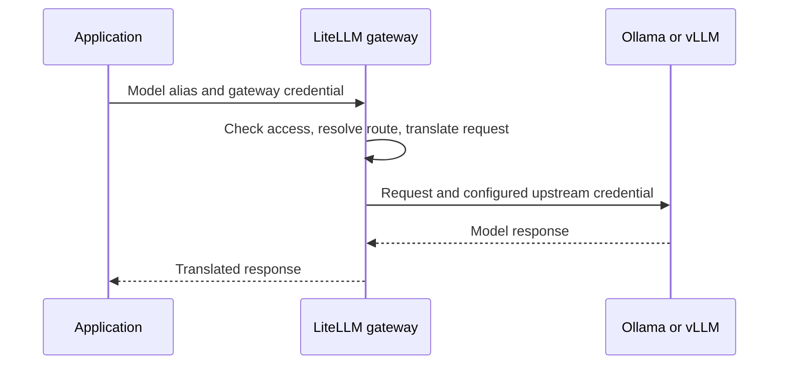

🗓️ 11102026 1520

# request_routing

**Request routing** maps the application's model alias to a serving backend and carries the response back.

## One request, two hops

The application uses a gateway key. The gateway separately supplies any upstream credential. Keep both outside prompts and tool arguments; configure limits and usage recording explicitly.

## Compatibility and tool calls

OpenAI-compatible APIs share request shapes, not identical feature support. Test options, structured output, and tool calls before switching backends.

A returned tool call goes back to the application for validation and execution. The result becomes input to the next model turn; [[tool_invocation_flow]] traces the optional MCP path.

## References

- [LiteLLM request lifecycle](https://docs.litellm.ai/docs/proxy/architecture)
- [vLLM OpenAI-compatible server](https://docs.vllm.ai/en/stable/serving/online_serving/openai_compatible_server/)
