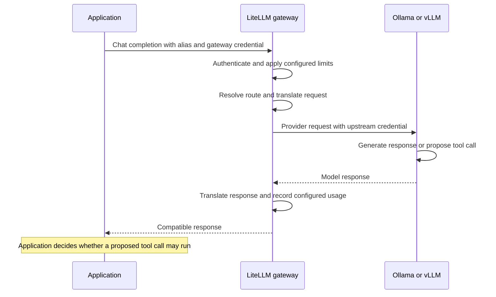

🗓️ 11102026 1520

# request_routing

A gateway keeps the application’s model interface separate from model serving.

## One request, two hops

The gateway can authenticate keys, enforce limits, route requests, and translate formats. It may also log usage. These features require configuration; an OpenAI-compatible endpoint alone does not prove they are enabled.

Each hop uses separate credentials: the application authenticates to the gateway, then the gateway authenticates upstream. Keep credentials out of prompts and tool arguments.

## Stable alias, replaceable model

The application sends an alias such as `assistant-default`. Gateway configuration maps it to a provider and model. Operators can change the target without changing the client, if request and tool-call behavior remain compatible.

An OpenAI-compatible API defines request and response shapes. It does not guarantee identical support for options, structured output, or tool calls. Test the model and serving version against the features your application needs.

## Tool calls return to the application

A tool call is a model proposal containing a function and arguments. The application validates and authorizes it, runs the tool, then sends back the result. The gateway transports these messages; it does not authorize tool execution.

See [[llm_tool_use]] for the model/application boundary and [MCP tool invocation](../mcp/tool_invocation_flow.md) for the optional external-connector path.

## References

- [LiteLLM request lifecycle](https://docs.litellm.ai/docs/proxy/architecture)
- [vLLM OpenAI-compatible server](https://docs.vllm.ai/en/stable/serving/online_serving/openai_compatible_server/)
- [Tool use with Claude: overview of the interaction pattern](https://platform.claude.com/docs/en/agents-and-tools/tool-use/overview)
