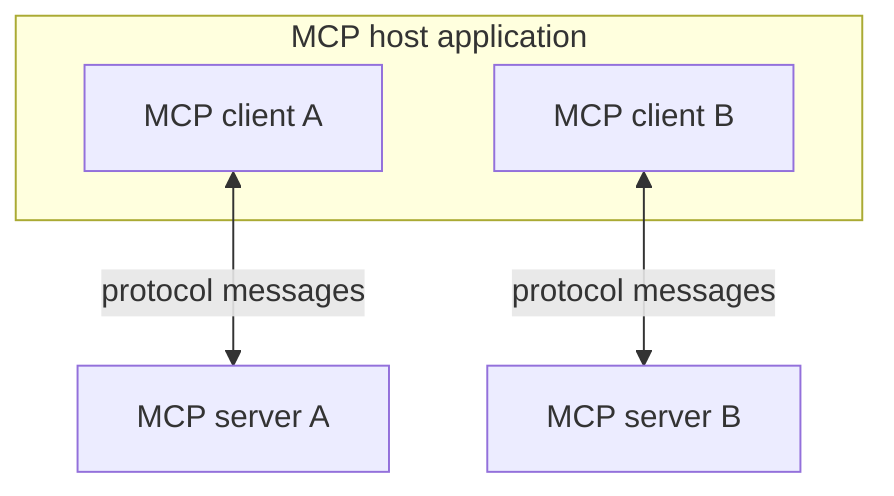

🗓️ 17102026 1526

# architecture

MCP splits an integration into three roles. The host application runs one client per server, and each client talks to exactly one server.

## Terms

| Term | Definition | Source |
|---|---|---|
| **MCP host** | The AI application that creates and manages MCP clients, one for each server it connects to. | [Architecture](https://modelcontextprotocol.io/docs/2026-07-28/learn/architecture#participants) |
| **MCP client** | A component inside the host that keeps a connection to one MCP server and fetches context from it for the host. | [Architecture](https://modelcontextprotocol.io/docs/2026-07-28/learn/architecture#participants) |
| **MCP server** | A program, local or remote, that provides tools, resources, or prompts to MCP clients. | [Architecture](https://modelcontextprotocol.io/docs/2026-07-28/learn/architecture#participants) |

## Host and server boundaries

- The host owns model integration and permissions.
- Each server controls access to its own upstream system.
- The host can contain an [[agent_runtime]].

See the [MCP overview](index.md) for what servers expose.

## Discovery and requests

In revision `2026-07-28`:

1. Optionally, `server/discover` returns server identity, capabilities, and supported versions.
2. The client lists capabilities, such as with `tools/list`.
3. The client sends requests, such as `tools/call`.

Each request carries its protocol version and client capabilities in `_meta`, and should carry client identity. Clients send requests; servers return responses and notifications. [[transports]] covers delivery.

Older revisions start with an `initialize` handshake instead. Match the peer's revision; don't mix lifecycle rules. [[sampling]] covers a deprecated client capability.

## References

- [MCP architecture, 2026-07-28](https://modelcontextprotocol.io/docs/2026-07-28/learn/architecture)
