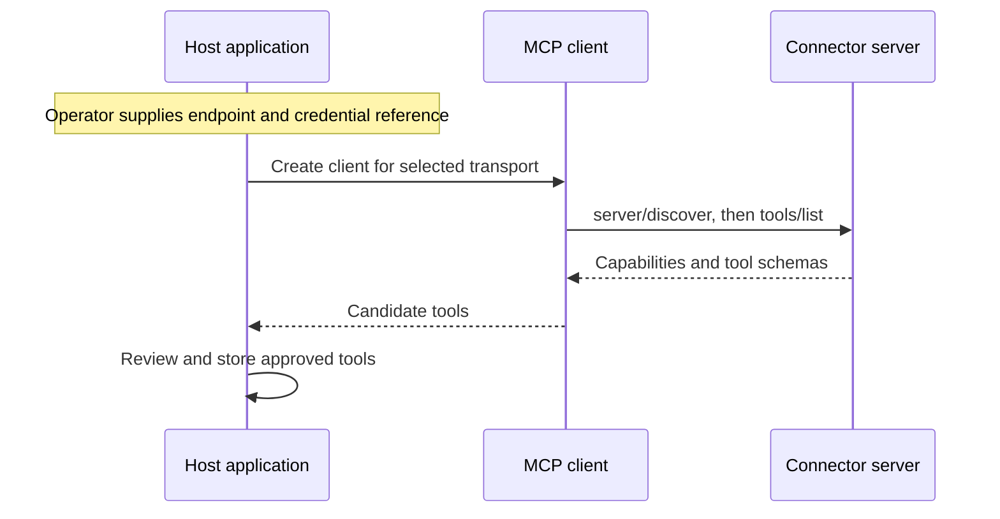

🗓️ 11102026 1520

# connector_registration_flow

**Connector registration** discovers an MCP server's capabilities and records what the host approves for use.

## Discovery is not approval

`tools/list` describes tools; the host separately approves them. Treat supplied metadata as untrusted. When lists or schemas change, refresh the catalogue and apply the host's review policy.

## Host registry

Store the endpoint, transport, credential reference, approved schemas, and permission rules. Give the model only relevant approved schemas; keep credentials and private policy outside its context.

Validate remote destinations and redirects. Network restrictions reduce **server-side request forgery**, where supplied URLs cause unintended server requests. [[tool_invocation_flow]] covers execution after registration.

## References

- [MCP tools specification](https://modelcontextprotocol.io/specification/2026-07-28/server/tools)
- [MCP security best practices](https://modelcontextprotocol.io/docs/2026-07-28/tutorials/security/security_best_practices)
