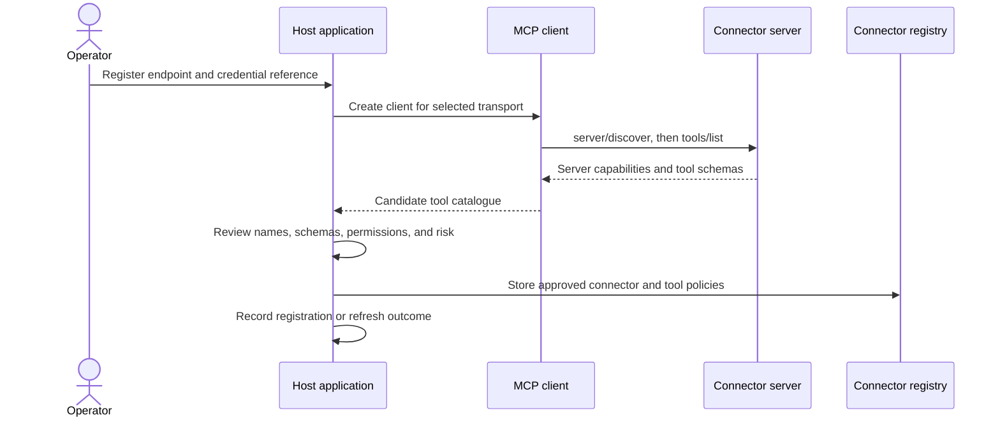

🗓️ 11102026 1520

# mcp_connector_registration_flow

Registration connects a host to an MCP server, discovers its capabilities, and records which of them the application is willing to use.

## Discovery is not approval

The MCP client speaks JSON-RPC using stdio or Streamable HTTP. `tools/list` returns descriptions and input schemas; it does not grant permission to use the tools. Treat server-provided names, descriptions, and annotations as untrusted metadata until the connector is reviewed.

The current specification allows tool lists to change. `tools/list` supports pagination and cache hints; servers should return a stable order while the list is unchanged. List-change notifications can help clients keep catalogues fresh. A host still needs a policy for schema changes: detect them, compare them with the approved version, and decide whether to require review again.

## What belongs in the host registry

Keep endpoint and transport settings, a server-side credential reference, discovered schema, approval state, and application permission/risk metadata. Never send connector credentials or private policy fields to the model. Expose only the approved tools relevant to the current user and request.

For remote connectors, the registration client fetches an operator-supplied endpoint and may follow authorization metadata URLs. Validate destinations and redirects, restrict private-network access where appropriate, and apply egress controls to reduce server-side request forgery risk.

MCP defines discovery messages; each application still chooses connector ownership, refresh policy, schema-change review, credential provisioning, and audit retention.

## References

- [MCP architecture and discovery](https://modelcontextprotocol.io/docs/2026-07-28/learn/architecture)
- [MCP tools specification](https://modelcontextprotocol.io/specification/2026-07-28/server/tools)
- [MCP transports](https://modelcontextprotocol.io/specification/2026-07-28/basic/transports)
- [MCP security best practices](https://modelcontextprotocol.io/docs/2026-07-28/tutorials/security/security_best_practices)
- [OWASP SSRF Prevention Cheat Sheet](https://cheatsheetseries.owasp.org/cheatsheets/Server_Side_Request_Forgery_Prevention_Cheat_Sheet.html)
