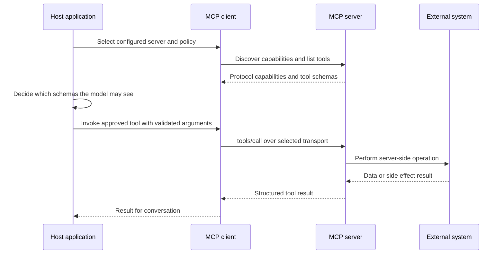

🗓️ 11102026 1520

# mcp

**Model Context Protocol (MCP)** is a standard message protocol for AI applications to discover and use capabilities exposed by separate servers. It standardizes the client-server exchange; the host application still decides what to expose to the model and whether to execute a requested action.

This note follows the current specification, revision `2026-07-28`, checked on 11 October 2026. Earlier revisions use different session and initialization behavior; follow the compatibility guidance when supporting older peers.

## The big picture

- The **host** is the AI application.
- A **client** is the host's connection to one server.
- A **server** exposes useful capabilities, such as a database query or a project file.

MCP makes the connection interoperable. The host still decides which servers to connect, which capabilities reach the model, and what actions are allowed.

## What a server can offer

| Capability | Purpose | Who normally chooses it |
|---|---|---|
| Tools | Perform an operation | Model, within host controls |
| Resources | Provide context or data | Host application |
| Prompts | Supply a reusable interaction template | User |

Start with [[llm_tool_use]] to understand tool calls. Continue to [[mcp_architecture]] for participants, or [[mcp_transports]] for wire behavior. Then follow [connector registration](connector_registration_flow.md) and [tool invocation](tool_invocation_flow.md) from setup through execution.

## Important boundary

MCP does not make a model autonomous, guarantee that a tool is safe, or grant access to data. Tool metadata is not an authorization policy. Validate and authorize each invocation at the host and server boundaries.

## References

- [[ai_overview]]
- [[llm_tool_use]]
- [[mcp_architecture]]
- [What is MCP?](https://modelcontextprotocol.io/docs/getting-started/intro)
- [Current MCP specification](https://modelcontextprotocol.io/specification/latest)
- [MCP tools](https://modelcontextprotocol.io/specification/2026-07-28/server/tools)
