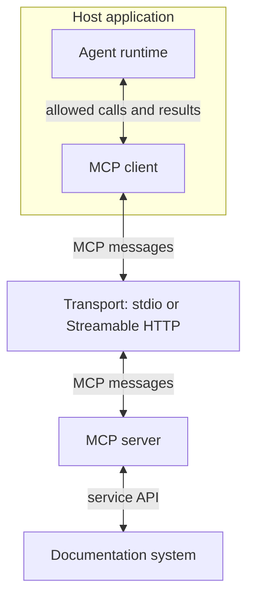

🗓️ 17102026 1518

# mcp

**Model Context Protocol (MCP)** standardizes how AI applications discover and use external tools and context. The application still controls access and execution.

## Terms

| Term | Definition | Source |
|---|---|---|
| **Data layer** | The part of MCP that defines what messages mean: the operations, lifecycle rules, and primitives such as tools, resources, and prompts. | [Architecture](https://modelcontextprotocol.io/docs/2026-07-28/learn/architecture) |

## Meaning versus delivery

The data layer stays the same whichever transport carries the messages.

Example: `tools/list` asks a documentation server for its tools, and `tools/call` runs its search tool. Both mean the same over stdio or Streamable HTTP.

## Who controls what

- The host picks which tool schemas the model sees.
- The model proposes a call; the host checks it first.
- The server enforces its own access and runs the operation.
- The host decides which results enter the next model request.

MCP leaves workflow and context management to the application; see [[agent_runtime]].

## Server capabilities

A documentation server might expose:

- A search tool.
- Document content as [[server_resources]].
- A review template as one of its [[prompts]].

## Reading path

1. [[llm_tool_use]]: how models propose calls.
2. [[architecture]]: hosts, clients, and servers.
3. [[transports]]: how messages travel.
4. [[connector_registration_flow]]: discovery to approved tools.
5. [[tool_invocation_flow]]: one call through execution.

Read [[authorization]] for remote access, or [[custom_servers]] before building a server.

These notes use revision `2026-07-28`. Older peers differ; check compatibility before implementing.

## References

- [MCP architecture and layers, 2026-07-28](https://modelcontextprotocol.io/docs/2026-07-28/learn/architecture)
- [MCP specification, 2026-07-28](https://modelcontextprotocol.io/specification/2026-07-28)
