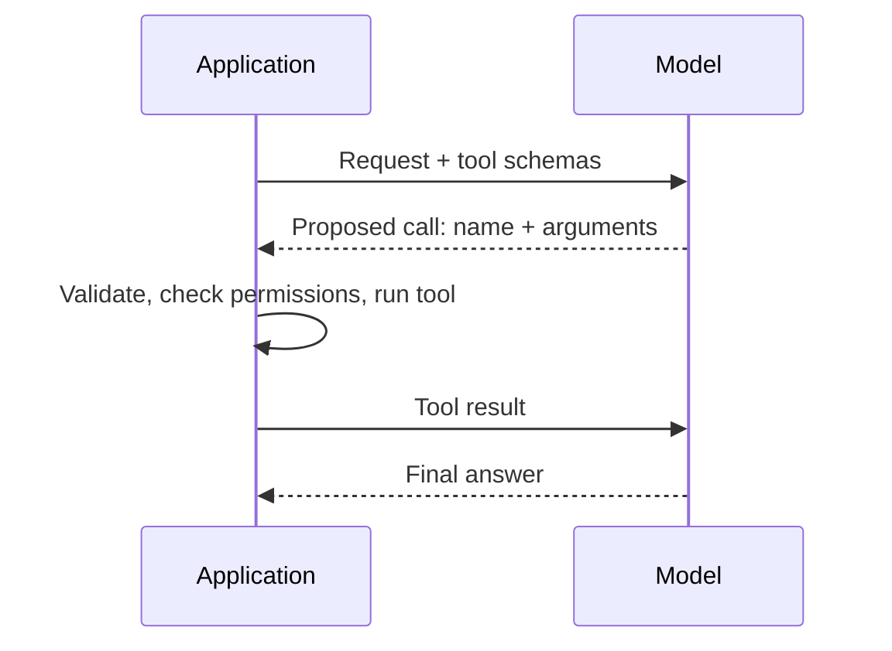

🗓️ 17102026 1518

# llm_tool_use

**Tool use** lets a model request an operation, such as a search, and use its result. The model only proposes the call; the application runs it.

## Terms

| Term | Definition | Source |
|---|---|---|
| **Tool schema** | A tool's name, description, and JSON Schema for its inputs. It tells the model what it can ask for and how. | [Tool use with Claude](https://platform.claude.com/docs/en/agents-and-tools/tool-use/overview) |

## Who controls execution

A schema grants no permission. The application decides what actually runs, and with which limits.

## Good tool candidates

- Fresh data the model wasn't trained on.
- Actions on external systems.
- Computation the model can't do reliably.

Prefer narrow tools, such as `search_docs`, over unrestricted shells.

[MCP](index.md) connects the application to external tool servers. [[agent_runtime]] repeats this exchange until the task is done.

## References

- [Tool use with Claude](https://platform.claude.com/docs/en/agents-and-tools/tool-use/overview)
