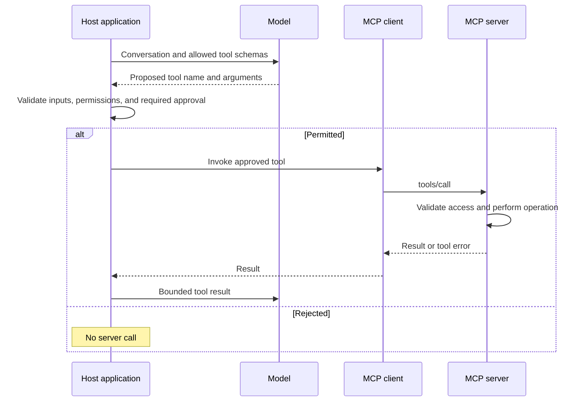

🗓️ 11102026 1520

# tool_invocation_flow

An MCP **tool invocation** turns a model proposal into a checked `tools/call` request.

## From prompt to tool result

The host maps the proposed name to an approved connector and checks the call. The server enforces its own access controls. The model uses the result for an answer or another proposal.

## Execution checks

- Check inputs, permissions, and required confirmation before execution.
- Bound duration, call count, and returned content.
- Record outcomes without logging secrets.
- Retry writes only when duplication is safely handled.

A protocol response can contain a tool error; inspect its status and content. A timed-out write may already have happened. MCP defines messages; application policy defines approvals and retries.

## References

- [MCP tools specification](https://modelcontextprotocol.io/specification/2026-07-28/server/tools)
- [MCP security best practices](https://modelcontextprotocol.io/docs/2026-07-28/tutorials/security/security_best_practices)
