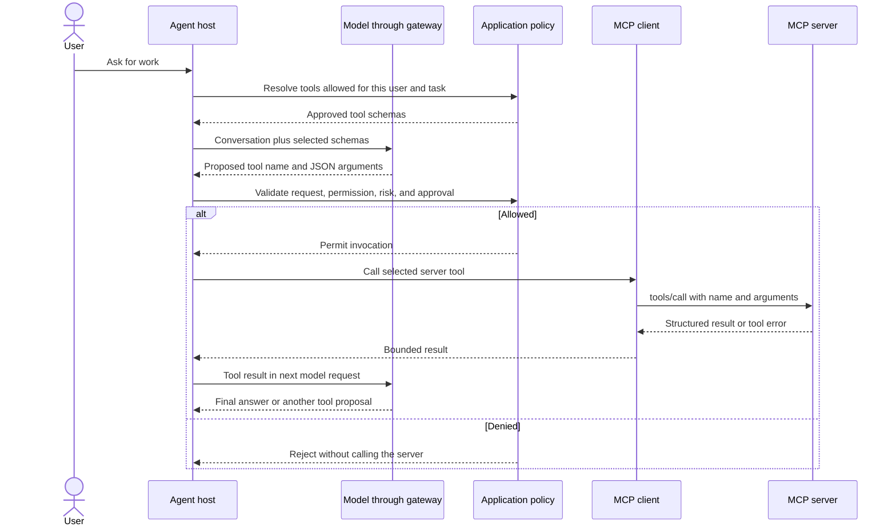

🗓️ 11102026 1520

# mcp_tool_invocation_flow

An MCP tool call is a protocol request from a client to a server. The model may propose it, but the host controls whether it is exposed and executed.

## From prompt to tool result

The model sees schemas and can return a structured call. The host maps that name to an approved connector, validates the arguments, checks current authorization, and applies any confirmation rule before the MCP client sends `tools/call`. The server validates again and performs the operation under its own access controls.

MCP standardizes the tool request and result. It does not define an application’s business authorization, approval screen, audit retention, or retries. A successful protocol response also does not prove that a requested business outcome occurred; interpret the returned content and server error status.

## Safe execution boundaries

- Filter schemas before the model request.
- Recheck authorization immediately before execution.
- Validate arguments against the approved schema and application rules.
- Require user confirmation for risky writes when product policy requires it.
- Bound duration, calls, and returned content.
- Record enough context for an audit without storing secrets.
- Do not blindly retry non-idempotent external writes.

The host should apply permission checks, confirmation rules, server-held credentials, result bounds, and audit policy around the protocol call. The approval interface and write retry/idempotency behavior depend on the application and external system.

## References

- [MCP tools specification](https://modelcontextprotocol.io/specification/2026-07-28/server/tools)
- [MCP security best practices](https://modelcontextprotocol.io/docs/2026-07-28/tutorials/security/security_best_practices)
- [Tool use with Claude: interaction pattern](https://platform.claude.com/docs/en/agents-and-tools/tool-use/overview)
