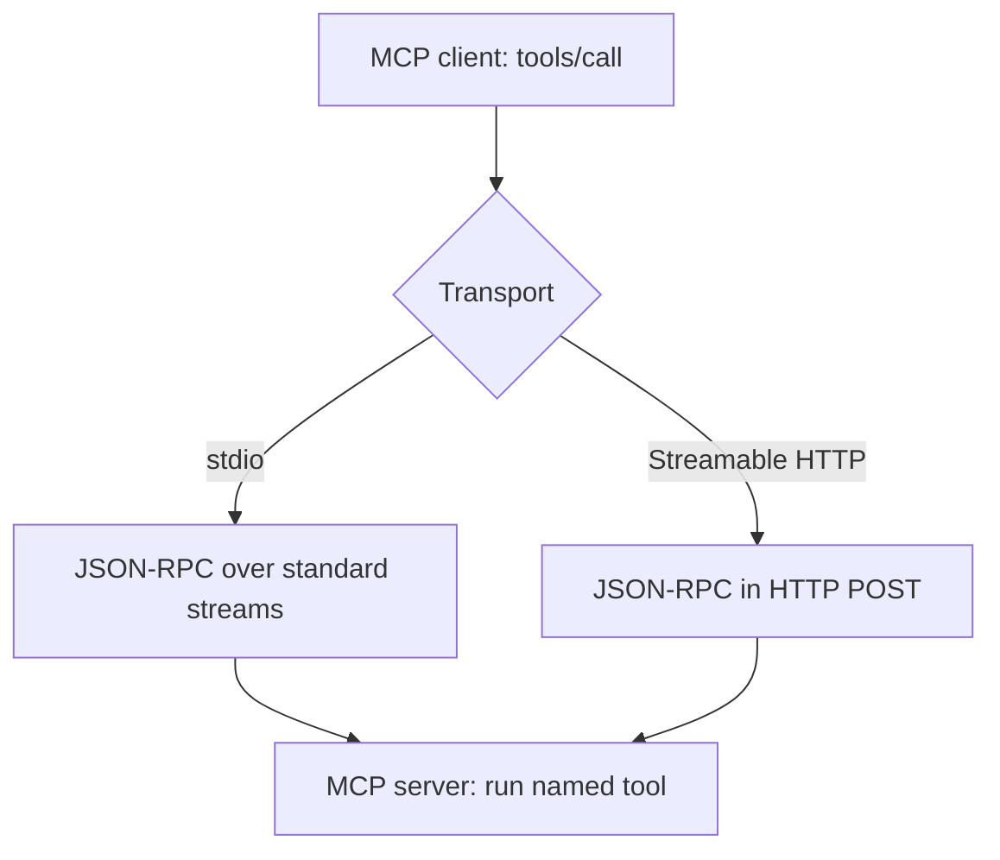

🗓️ 17102026 1526

# transports

Pick an MCP transport by how the server runs: as a local process or as a separate service. Read the [MCP overview](index.md) first.

## Terms

| Term | Definition | Source |
|---|---|---|
| **Transport layer** | The part of MCP that frames messages and delivers them between client and server, separate from what they mean. | [MCP transports](https://modelcontextprotocol.io/specification/2026-07-28/basic/transports) |
| **stdio** | A transport where the client launches the server as a subprocess and exchanges newline-delimited messages over its standard input and output. | [MCP transports](https://modelcontextprotocol.io/specification/2026-07-28/basic/transports) |
| **Streamable HTTP** | A transport where the client sends each message as an HTTP POST to a server running as its own service. | [MCP transports](https://modelcontextprotocol.io/specification/2026-07-28/basic/transports) |
| **JSON-RPC** | A lightweight remote procedure call format that encodes requests, responses, and notifications as JSON. MCP messages use it. | [JSON-RPC 2.0](https://www.jsonrpc.org/specification) |
| **Server-sent events (SSE)** | A web standard that lets a server push a stream of messages to a client over one open HTTP response. | [MDN](https://developer.mozilla.org/en-US/docs/Web/API/Server-sent_events) |

## Same operation, different carriers

A `tools/call` request keeps the same tool name and arguments on either transport. Only transport metadata can differ.

## Choosing a transport

### Client-launched process

Use stdio when the client starts the server locally.

- Requests go to the server's standard input; replies come from standard output.
- Send logs to standard error. Standard output carries protocol messages only.

### Separate service

Use Streamable HTTP for a server running on its own, local or remote. Replies come back as JSON or as an SSE stream scoped to the request.

## Version and access limits

- These notes target revision `2026-07-28`.
- In this revision, closing a request's HTTP response stream cancels it.
- Older revisions have different lifecycle rules.
- Choosing a transport grants no permissions or approvals.

See [[authorization]] for protected HTTP access and [[tool_invocation_flow]] for execution checks.

## References

- [MCP transports specification, 2026-07-28](https://modelcontextprotocol.io/specification/2026-07-28/basic/transports)
- [Streamable HTTP](https://modelcontextprotocol.io/specification/2026-07-28/basic/transports/streamable-http)
