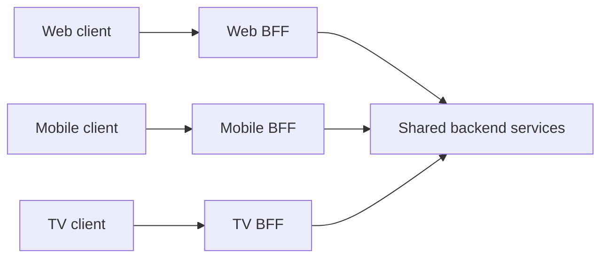

🗓️ 11092025 1355

# backend_for_frontend

> **Backend for frontend (BFF)**: A backend service tailored to the needs of a particular user interface or client type. ([Microsoft architecture guidance](https://learn.microsoft.com/en-us/azure/architecture/patterns/backends-for-frontends))

A BFF adapts general-purpose backend services for a client such as a web app, mobile app, or TV. It can combine calls and shape responses so each client makes fewer requests and receives only the data it needs.

## When it helps

Use a BFF when clients have meaningfully different data, interaction, or authentication needs. It can aggregate backend calls and adapt payloads while leaving core business rules in shared backend services.

A BFF adds another service to deploy and maintain. Avoid one when clients use the same API, or when a small application can serve them through a shared endpoint. Keep each BFF focused on client adaptation; duplicated business rules and UI-component-level endpoints make changes harder to coordinate.

## Boundaries

An [[gateway_patterns]] provides shared entry-point concerns such as routing and authentication. A BFF adds client-specific composition and can sit behind a gateway. GraphQL lets clients select fields through a shared API; it can reduce the need for separate BFFs when clients can safely control their queries.

For routing at an application boundary, see [[reverse_proxy]].

## References

- [Microsoft: Backends for Frontends pattern](https://learn.microsoft.com/en-us/azure/architecture/patterns/backends-for-frontends)
- [Sam Newman: Backends for Frontends](https://samnewman.io/patterns/architectural/bff/)
