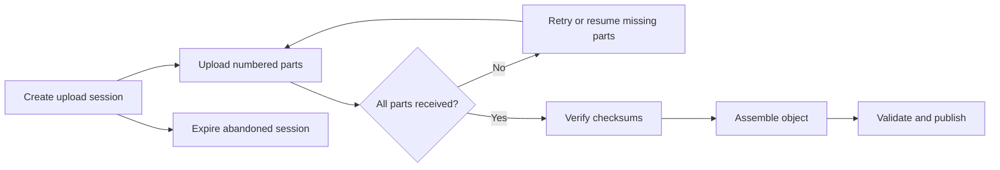

🗓️ 09092025 1151

# chunked_uploading

Chunked upload divides a large file into independently transferred parts. The client can retry failed parts and resume an upload when the server persists session state.

## Upload lifecycle

## Design decisions

- **Part size:** balance request overhead, memory use, retry cost, and service limits. There is no universal best size.
- **Identity:** associate each part with an upload session and part number.
- **Idempotency:** retrying the same part should not create a duplicate part.
- **Integrity:** verify checksums and the assembled file before publishing it.
- **Concurrency:** bound parallel parts to protect the client and storage service.
- **Cleanup:** expire incomplete sessions and remove temporary data.
- **Authorization:** bind the upload session to an authenticated owner and expected object.

Use chunking when file size, unreliable networks, retry cost, or provider requirements justify the extra protocol state. For example, Amazon S3 defines multipart upload part-count and size limits; other providers differ.

## References

- [Amazon S3: Multipart upload limits](https://docs.aws.amazon.com/AmazonS3/latest/userguide/qfacts.html)
- [[idempotency_keys_api_design]]
