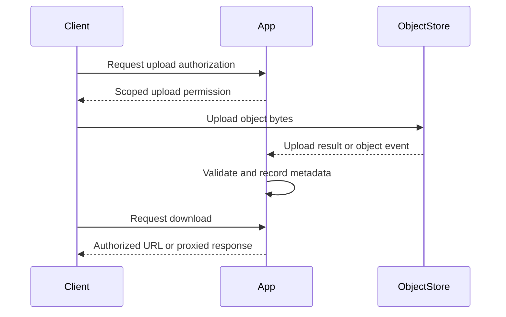

🗓️ 17102026 2135

# cloud_storage

Object storage exposes objects through a service API; applications still own the upload, access, and lifecycle workflows around them.

An object typically has a key, data, and metadata inside a bucket. A key that looks like a folder path is generally a naming convention over object keys, not a filesystem directory with POSIX semantics. Use object storage for durable blobs and large files; use a database for transactional metadata and relationships that need queries or constraints.

## What the service can provide

Depending on provider, region, and storage class, managed object storage can provide redundant storage, access control, encryption, versioning, multipart uploads, lifecycle transitions, and request logging. These features have configuration choices and costs. A durability target is a statistical service objective, not a promise that an individual object can never be deleted, overwritten, or become unavailable.

## What the application still owns

- Authorization: decide who may upload, read, replace, and delete each object.
- Metadata: store ownership, relationships, processing state, and the object key.
- Upload workflow: handle retries, incomplete multipart uploads, validation, and cleanup.
- Delivery: choose signed URLs, a proxy, or a CDN based on access and privacy needs.
- Lifecycle and cost: define retention, version cleanup, storage classes, and egress budgets.
- Media processing: transcode, validate, and generate manifests or thumbnails when needed.

For large uploads, use multipart APIs or provider SDKs that support resumable uploads. Configure lifecycle cleanup for abandoned parts. See [[chunked_uploading]].

For caching and delivering public or authorized content, see [[cdn]]. For serving files through an application boundary, see [[reverse_proxy]]. For safe retry semantics for upload requests, see [[idempotency_keys]].

## References

- [Alibaba Cloud OSS: What is Object Storage Service?](https://www.alibabacloud.com/help/en/oss/user-guide/what-is-oss)
- [Alibaba Cloud OSS: Multipart upload](https://www.alibabacloud.com/help/en/oss/user-guide/multipart-upload)
- [Alibaba Cloud OSS: Lifecycle management](https://www.alibabacloud.com/help/en/oss/user-guide/overview-54/)
