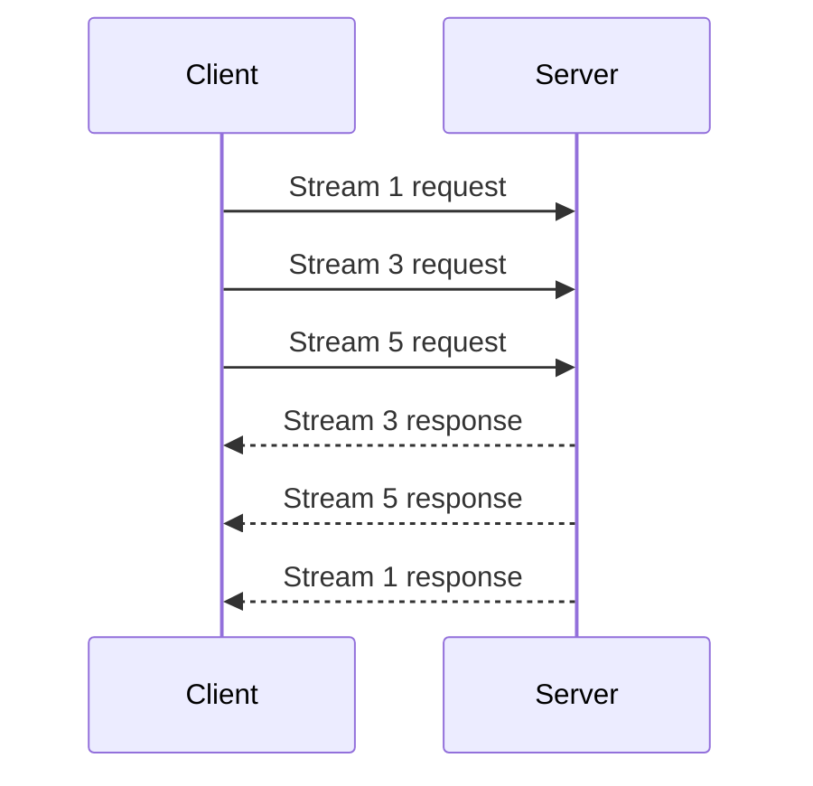

🗓️ 09092025 1449

# http_2_multiplexed_conditions

HTTP/2 multiplexes independent request and response streams over one connection. A slow response on one stream does not require HTTP/1.1-style request serialization at the application layer.

## What multiplexing helps

- Reuses a connection for concurrent requests.
- Removes HTTP/1.1 application-layer head-of-line blocking caused by a serialized request/response exchange.
- Allows flow control and prioritization mechanisms to coordinate stream data.

## Boundary

HTTP/2 commonly runs over TCP. Packet loss can delay bytes for all streams on that connection, so TCP head-of-line blocking remains. Multiplexing does not guarantee a fixed latency improvement; effects depend on network conditions, server behavior, and request mix.

## References

- [RFC 9113: HTTP/2](https://www.rfc-editor.org/rfc/rfc9113.html)
