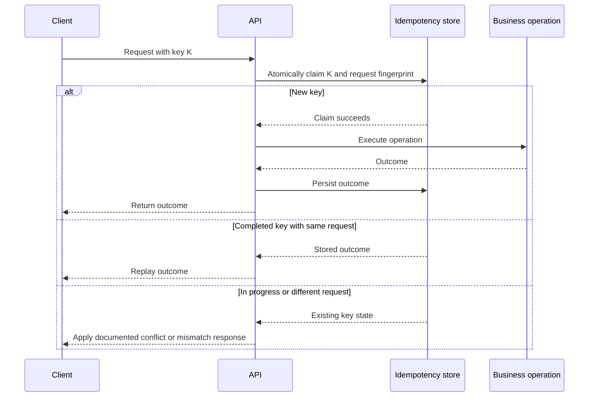

🗓️ 29042026 1300

# idempotency_keys

An idempotency key lets a client retry one logical operation without repeating its effect. The server records the key and outcome, then reuses that outcome for a completed retry. It pairs with bounded [[retry_backoff_jitter]] when transient failures require retries.

> **Idempotency key**: A client-generated value that lets a resource recognize retries of the same request. The client must not reuse the value for a different request. ([IETF Internet-Draft](https://datatracker.ietf.org/doc/draft-ietf-httpapi-idempotency-key-header/))

## Server contract

The server scopes keys to the caller or tenant and stores a fingerprint of the request. A unique constraint or equivalent atomic operation ensures concurrent requests cannot both claim the same key. A completed retry returns the stored outcome; an in-progress retry follows a documented wait or conflict policy.

When the business write and key record share a database, commit them in one transaction. A database transaction cannot include an external payment provider or message broker. Pass the key downstream when supported, or use a durable handoff such as [[outbox]]. In a multi-service workflow, make each [[saga]] step idempotent. [[idempotent_consumer_pattern]] applies the same principle to message delivery.

## Decisions and edge cases

- Generate a high-entropy key per logical operation and reuse it only for retries.
- Reject a reused key when its request fingerprint differs. The IETF draft recommends 422 for this case; document the API's actual response.
- Define an expiry window that covers expected client retries and operational replay. Expired keys may allow the operation to run again.
- Decide how long-running requests expose progress. An API may return a conflict during processing or expose an asynchronous operation resource.
- Do not treat the key as authentication. Authorize every request independently.

HTTP method semantics are separate: [[http_methods_idempotency_safety]] explains why PUT and DELETE are idempotent by definition, while POST is not. An idempotency key adds application-level retry protection to an operation.

Stripe allows keys to be pruned after at least 24 hours. It does not save results for validation failures or concurrent requests that conflict before endpoint execution. These are provider-specific rules, not universal defaults.

## References

- [Stripe: Idempotent requests](https://docs.stripe.com/api/idempotent_requests)
- [IETF Internet-Draft: Idempotency-Key HTTP header field](https://datatracker.ietf.org/doc/draft-ietf-httpapi-idempotency-key-header/)
