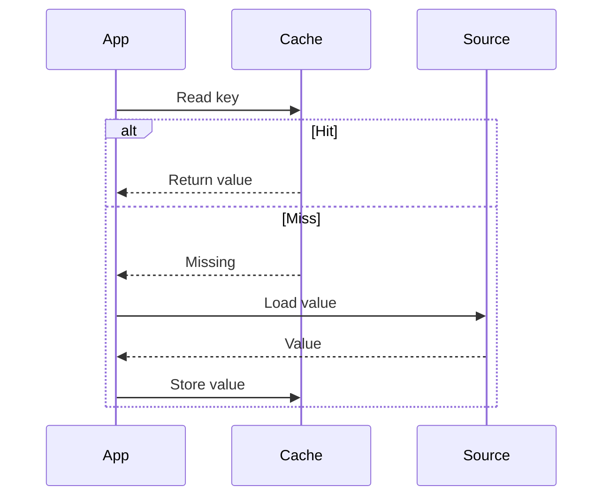

🗓️ 29042026 1900

# aside_pattern

**Cache-aside** puts the application in charge of cache lookup, loading, and invalidation. The source remains authoritative; cached entries are disposable copies.

Read [[fundamentals]] for entry lifecycle terms.



## Read and write paths

Schematic pseudocode; `MISSING` differs from a cached empty result.

```text
read(key):
  entry = cache.get(key)
  if entry != MISSING:
    return entry.value
  value = source.get(key)
  cache.set(key, value, ttl)
  return value

write(key, value):
  source.commit(key, value)
  cache.delete(key)
```

Commit before invalidation so the next miss can fetch the update. Represent absence explicitly if using [[penetration]] protection.

## Why choose it

- Loads only requested data.
- Works with a separate cache and source.
- Keeps loading policy in application code.

Compare [[read_through]] when a loader should own the miss path.

## Boundaries

Every write path must invalidate affected entries. Concurrent readers can still cache older results; [[consistency]] explains the race.

A cache outage increases source traffic. Fallback works only if the source has capacity; plan for [[avalanche]].

Concurrent misses for one expensive result need [[stampede]] protection.

## References

- [Microsoft: Cache-Aside pattern](https://learn.microsoft.com/en-us/azure/architecture/patterns/cache-aside)
- [AWS: Caching strategies](https://docs.aws.amazon.com/AmazonElastiCache/latest/dg/Strategies.html)
