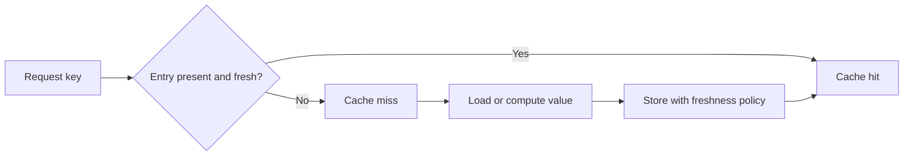

🗓️ 11102026 0132

# fundamentals

A **cache** stores reusable results near the reader. A hit avoids source work; a miss still needs that work. Caching helps when reuse outweighs lookup and maintenance costs.

These notes cover application data caches. Start with [[aside_pattern]] to see the read and write paths.

## Entry lifecycle

| Term | Meaning |
| --- | --- |
| Hit | A usable entry exists. |
| Miss | No usable entry exists. |
| Time to live (TTL) | How long an entry remains eligible for reuse. |
| Expiration | An entry becomes unusable after its lifetime. |
| Eviction | An entry leaves to free capacity. |
| Invalidation | An entry becomes unusable after a source change. |
| Refresh | A newer result replaces an existing entry. |

No TTL prevents expiration, but does not prevent eviction.

## What a hit rate tells you

**Hit rate** is hits divided by lookups. It measures reuse, not correctness.

At 1,000 lookups/second with 90% hits, about 100 misses/second remain. A cold cache can expose the source to all 1,000.

Check source latency, miss concurrency, memory usage, and stale responses. A high hit rate can hide expensive misses.

## Two design questions

Decide how old a result may be: [[consistency]].

Decide how much miss traffic the source can absorb: [[failure_modes]].

## References

- [Microsoft: Caching guidance](https://learn.microsoft.com/en-us/azure/architecture/best-practices/caching)
- [AWS: Caching challenges and strategies](https://aws.amazon.com/builders-library/caching-challenges-and-strategies/)
