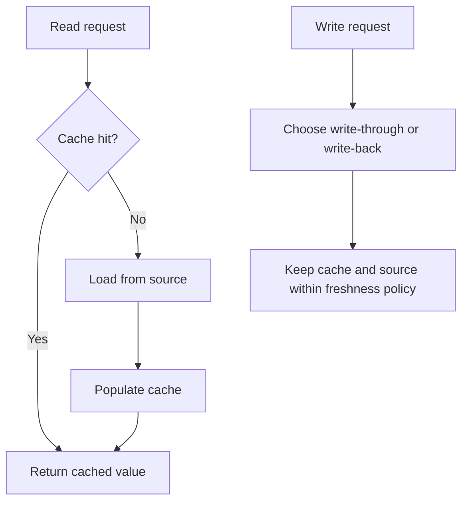

🗓️ 29042026 2025

# caching

Start here to understand cache behavior, choose read and write paths, and protect the source when entries are missing.

## Reading path

1. [[fundamentals]]: entry lifecycle and hit-rate interpretation.
2. [[aside_pattern]]: application-managed loading and invalidation.
3. [[consistency]]: stale fills and freshness guarantees.
4. [[read_write_patterns]]: compare loading and persistence.
5. [[failure_modes]]: identify the miss pattern.

## Follow the problem

| Question | Next note |
| --- | --- |
| Who should handle misses? | [[read_through]] |
| Should writes wait for source persistence? | [[write_through]], [[write_back]] |
| Why do absent keys keep reaching the source? | [[penetration]] |
| How can we reject absent keys cheaply? | [[bloom_filter]] |
| Why does one miss trigger many source loads? | [[stampede]] |
| What if many entries disappear together? | [[avalanche]] |

## Apply it

For a product catalog, choose the tolerated stale age, read path, write policy, and fallback load limit. Explain what happens after an update, a hot-key expiry, and a cache outage.

Use [[distributed_lock]] for shared load coordination. Read [[cluster_topology]] for storage topology and failover behavior.

## References

- [Microsoft: Caching guidance](https://learn.microsoft.com/en-us/azure/architecture/best-practices/caching)
- [AWS: Caching strategies](https://docs.aws.amazon.com/AmazonElastiCache/latest/dg/Strategies.html)
