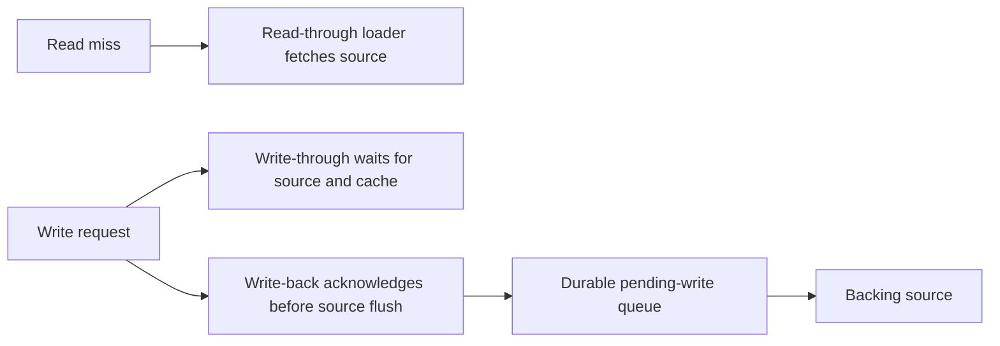

🗓️ 29042026 1915

# read_write_patterns

Read-through describes the read path. Write-through and write-back describe write acknowledgment and persistence. They are separate choices and can be combined.

## Compare responsibilities

| Pattern | Who handles a miss? | Write behavior |
| --- | --- | --- |
| [[aside_pattern]] | Application | Source commit, then cache invalidation. |
| [[read_through]] | Cache loader | A separate write policy is required. |
| [[write_through]] | A separate read policy | Success waits for source and cache updates. |
| [[write_back]] | A separate read policy | Source persistence follows acknowledgment. |

## Choose by need

- Explicit application loading: aside pattern.
- Loader-managed reads: read through.
- Synchronous source persistence and cache population: write through.
- Deferred persistence and batching: write back.

Specify [[consistency]] and failure recovery separately. A pattern name does not establish either guarantee.

## References

- [AWS: Caching strategies](https://docs.aws.amazon.com/AmazonElastiCache/latest/dg/Strategies.html)
- [Ehcache: Write-through and write-behind caching](https://www.ehcache.org/documentation/2.8/apis/write-through-caching.html)
