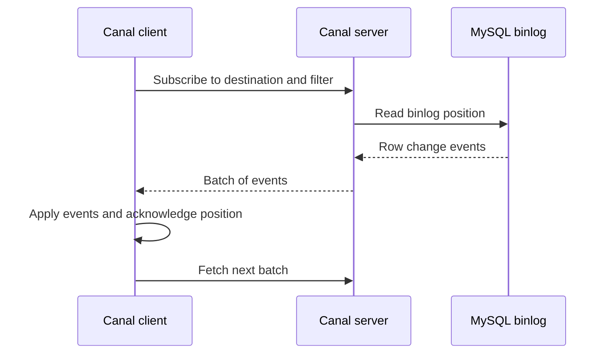

🗓️ 06042024 1357

# api_client

![[aliyun_canal_client.png]]

## Components

### ClientIdentity

- An id that will be exchanged with a `canal_server`

### CanalConnector

- 2 available implementations
  - `SimpleNodeAccessStrategy`: Interacting with **single** IP address (server)
  - `ClusterNodeAccessStrategy` : Interacting with **multiple** IP addresses

### CanalNodeAccessStrategy

- Strategy interface for interacting with `canal_server` nodes
- `SimpleNodeAccessStrategy`
  - **Single static list** of IP addresses
  - If 1 server in the list fails, try the next address
- `ClusterNodeAccessStrategy`
  - Interacts with `Zookeeper` to discover active `canal_server` nodes

## Client-Server interaction

### GET / ACK / Rollback protocol

### Message

- Return result of `get` operations
- Contains
  - `batchId`
  - `Entries`

### getWithoutAck()

- `Message getWithoutAck(int batchSize, Long timeout, TimeUnit unit)`
  - Return when `batchSize` reached / timeout exceeded
- `Message getWithoutAck(int batchSize)`

### Rollback

- `rollback(batchId)`: Rollback for last get operation

### Ack

- `ack(batchId)`: Acknowledge consumption of `get`

### Streaming API design

- `get` can be called multiple times in succession and later submit the `ack` / `rollback` **asynchronously** in sequence

---

## References

- https://github.com/alibaba/canal/wiki/ClientAPI
- https://alibaba.github.io/canal/apidocs/1.0.13/com/alibaba/otter/canal/client/CanalConnector.html
