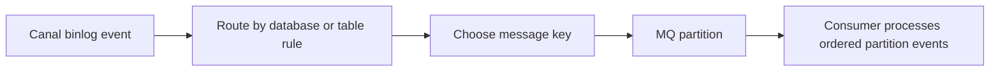

🗓️ 09042024 0948

# mq_client



## Partitioning Strategies

```ad-important
Affects ordering / rate at which messages are consumed
```

### Single Topic, Single Partition

- 😀 Guarantees ordering
- 🙁 Not good write performance

### Multiple topics, each single partition

- 😀 Guarantees ordering
- 🙁Not recommended for _hot_ (tables with high write frequency) tables

### Single / multiple topics, each multiple partitions (PK key)

- Partition based on a specified key

```
canal.mq.partitionHash=mytest.person:id,mytest.role:id
```

- 😀 Ordering within each partition guaranteed
- 😀 Good write performance
- 🙁 Carefully consider how to use PKEY ()

---

## References

- https://github.com/alibaba/canal/wiki/Canal-Kafka-RocketMQ-QuickStart
