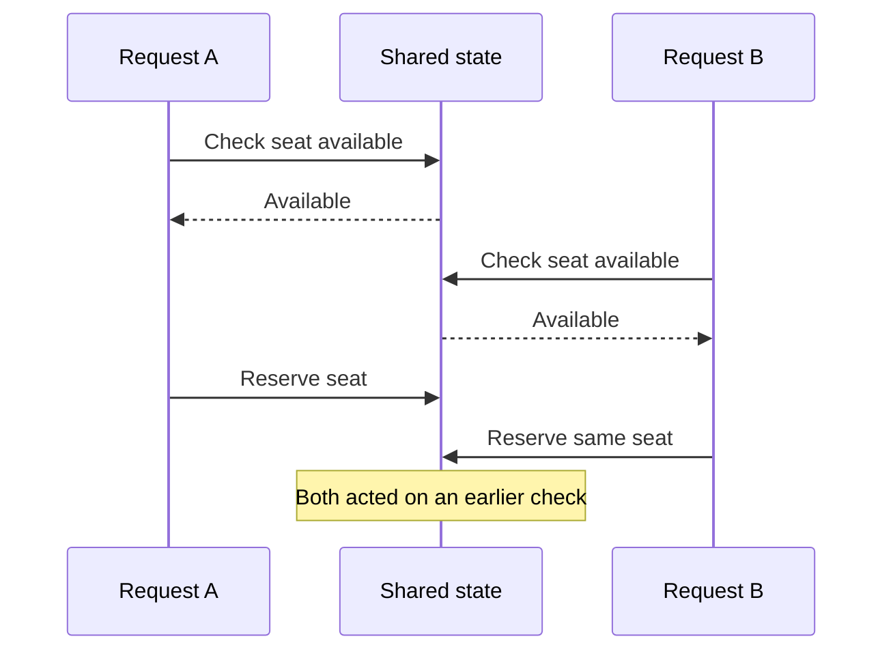

🗓️ 18102026 1625

# check_then_act

> **Check-then-act**: A workflow that checks a condition and later performs an action that depends on it.

It is safe only when the condition stays valid until the action, or when the check and action are coordinated as one operation. If another actor can change the state in between, the action may use an outdated result. The security-specific form is [[time_of_check_to_time_of_use]].

## The race window

For example, two requests both check that a seat is available. Each sees the same available state, then each attempts to reserve it. A check by itself does not reserve the seat.

The bug is the gap between observing a condition and claiming or changing the resource. In databases, a transaction snapshot can also be old while locking operations inspect current rows; see [[mvcc_innodb_read_view]] and [[write_skew]].

## Make the decision atomic

- Combine the condition and change in one atomic statement when possible.
- Use a lock that covers the state used by the decision.
- Use a version check and retry if another actor changed it.
- Add a constraint that rejects invalid combined outcomes.

Each option has a scope. A row lock cannot protect an invariant stored across unprotected rows, and a version check helps only when every relevant update changes the checked version.

## References

- [PostgreSQL: Transaction Isolation](https://www.postgresql.org/docs/current/transaction-iso.html)
- [[optimistic_locking]]
