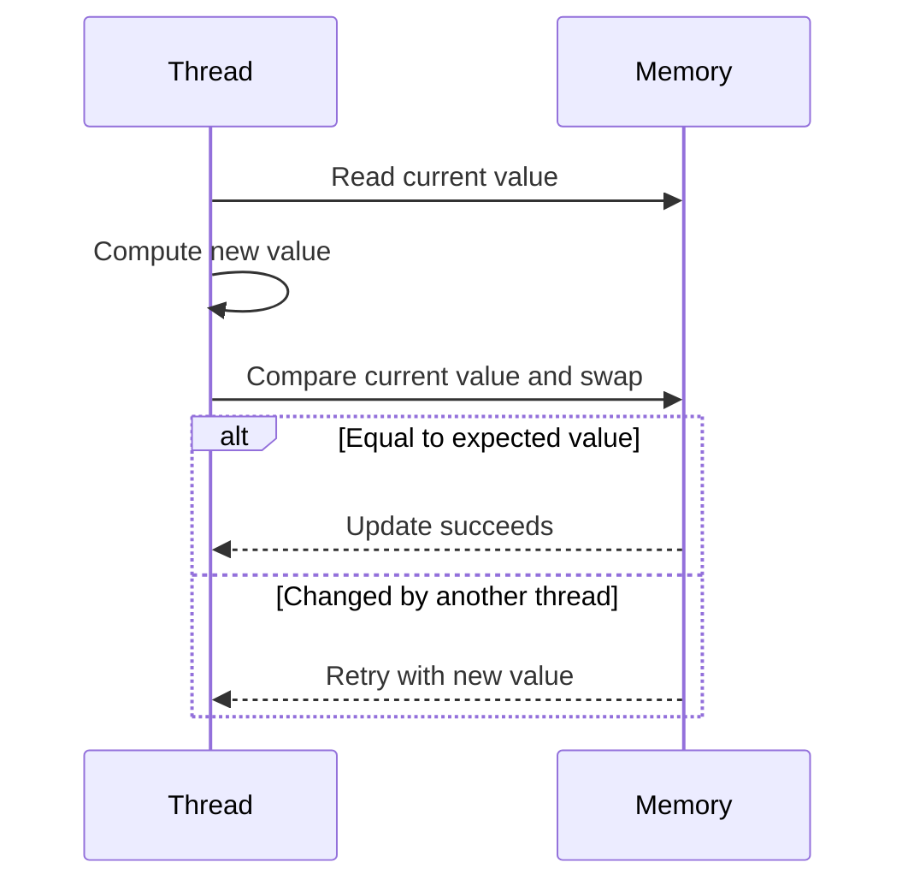

🗓️ 13032026 1200

# compare_and_swap



## What Is CAS?
- A CPU-level atomic instruction: "set this value to X **only if** it's currently Y"
- If another thread changed it in between, CAS fails and you retry
- Used by `AtomicInteger`, `ConcurrentHashMap`, and lock-free algorithms
- **No blocking** — threads don't wait, they just retry (called "spinning")

```java
// Pseudocode for what AtomicInteger.incrementAndGet() does:
do {
    current = read(value);         // read current value
    next = current + 1;
} while (!cas(value, current, next)); // retry if someone else changed it
```

## CAS vs Locking

| Approach | How it works | Tradeoff |
|---|---|---|
| **Locking** (`synchronized`) | Block other threads | Safe but threads wait |
| **CAS** (lock-free) | Retry on conflict | No blocking but wastes CPU on retries under high contention |

---
## References
- [[cpu_cache_and_memory_visibility]]
- [[concurrency_data_structures]]
