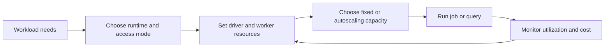

🗓️ 05092025 1514

# databricks_cluster_config

Databricks compute configuration describes the runtime, driver and worker capacity, scaling policy, and security mode for a workload. The available options depend on cloud, compute type, workspace policy, and runtime version.

## Main decisions

| Decision | What it controls | How to choose |
|---|---|---|
| Runtime version | Spark and Databricks libraries | Pin and test a supported version; prefer an LTS release for operational jobs when stability matters. |
| Driver and worker types | Memory, CPU, storage, and network capacity | Match the workload profile; size the driver for coordination and result collection. |
| Worker count | Parallel task capacity | Use fixed capacity for predictable demand or autoscaling for variable demand. |
| Photon | Accelerated execution for supported operations | Benchmark representative queries; unsupported operations can fall back to Spark. |
| Access mode and policy | Isolation and allowed configuration | Follow workspace governance and data-access requirements. |
| Auto-termination | Idle compute lifetime | Set an inactivity window that fits job and interactive use. |

## Configuration boundaries

- `autoscale` and a fixed `num_workers` represent alternative sizing modes in the Clusters API.
- Cloud instance families and prices vary; choose from the workspace's supported options.
- Photon speedups depend on operators, data, and runtime. Avoid assuming a fixed multiplier.
- Policies can hide or restrict settings. A valid configuration depends on workspace permissions.
- Treat Spark configuration values as workload-specific. Measure changes with the Spark UI and representative jobs.

## References

- [Databricks: Compute configuration reference](https://docs.databricks.com/aws/en/compute/configure)
- [Databricks: Classic compute best practices](https://docs.databricks.com/aws/en/compute/cluster-config-best-practices)
- [Databricks: What is Photon?](https://docs.databricks.com/aws/en/compute/photon)
