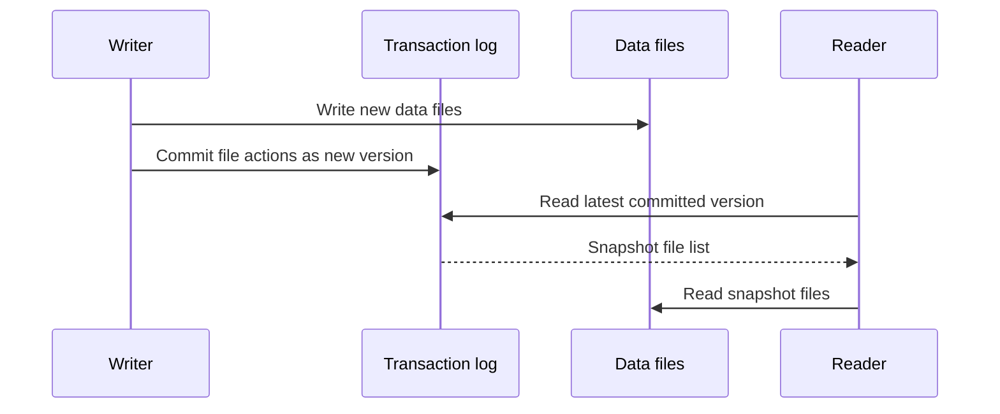

🗓️ 06032025 1830

# delta_lake

Delta Lake adds a transaction log and table semantics to files in a data lake. This supports consistent reads and writes, schema checks, versioned data, and batch or streaming access.

## What it provides

- **Transactions:** coordinate changes to a table through its transaction log.
- **Schema enforcement and evolution:** reject incompatible writes or update the table schema deliberately.
- **Version history:** read prior table versions and support rollback workflows.
- **Data changes:** support operations such as `UPDATE`, `DELETE`, and `MERGE` through compatible engines.
- **Batch and streaming:** use a table as a batch dataset or a streaming source or sink.

Delta Lake is a table format and protocol. Features depend on the engine and version used to read or write a table.

## References

- [Delta Lake documentation](https://docs.delta.io/)
- [[ACID]]
- [[apache_spark]]
