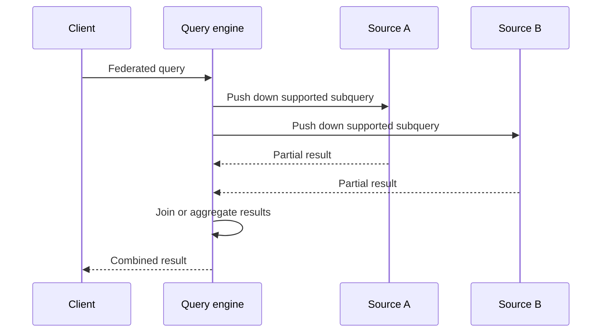

🗓️ 07082025 1038

# federation

**Data federation** lets a query engine access multiple data sources through one query interface, often without first copying all data into one store.

## Query path

1. A client submits a query to a federated engine.
2. Connectors translate parts of the query for supported sources.
3. The engine pushes down filters or projections when a connector supports them.
4. The engine combines returned data and sends results to the client.

## Trade-offs

- Data stays in its source, reducing some copying and synchronization work.
- Query latency depends on source availability, network distance, connector behavior, and pushdown support.
- Joins across sources can move large amounts of data through the query engine.
- Source permissions and type semantics must be mapped correctly.
- A federated query does not automatically provide a consistent snapshot across independent systems.

Federation suits exploratory queries and access patterns that tolerate source-dependent latency. Repeated, latency-sensitive analytics may benefit from materializing data into a shared store. Tools such as Trino and Athena provide connectors, with capabilities that vary by source.

## References

- [Trino: Concepts and connectors](https://trino.io/docs/current/overview/concepts.html)
- [Amazon Athena: Federated Query](https://docs.aws.amazon.com/athena/latest/ug/federated-queries.html)
