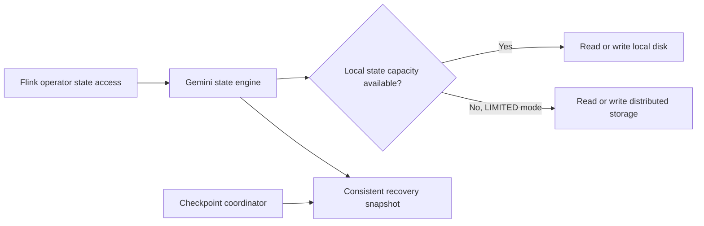

🗓️ 17102026 2135

# gemini_state_backend

GeminiStateBackend is Alibaba Cloud Realtime Compute for Apache Flink's managed key-value state backend; it is not part of open-source Apache Flink.

Alibaba describes Gemini as an LSM-based state engine designed for stream-processing access patterns. It supports adaptive state placement, hot/cold tiering, and compute-storage separation. In the documented `LIMITED` mode, state uses local disk first and spills to distributed storage when local capacity is insufficient; configuration and defaults depend on the managed runtime version.

Keep three concepts separate:

- **State backend:** how the running job stores and accesses managed state.
- **Checkpoint:** a consistent recovery snapshot of state and source positions.
- **Checkpoint storage:** where checkpoint snapshots are persisted.

Gemini's storage capabilities do not by themselves guarantee end-to-end exactly-once output or a particular recovery time. Those depend on the runtime version, checkpoint configuration, sources, sinks, state size, and storage behavior. Alibaba's performance comparisons are vendor benchmarks for the tested workloads, not a general guarantee.

For Flink-managed state concepts, see [[state]]. For consistent recovery snapshots, see [[checkpointing]]. For separating compute from storage, see [[storage_disaggregation_architecture]].

## References

- [Alibaba Cloud: GeminiStateBackend](https://www.alibabacloud.com/help/en/flink/realtime-flink/user-guide/geministatebackend)
- [Alibaba Cloud: Checkpoint and savepoint FAQ](https://www.alibabacloud.com/help/en/flink/realtime-flink/support/faq-about-checkpoints-or-savepoints-of-a-deployment)
