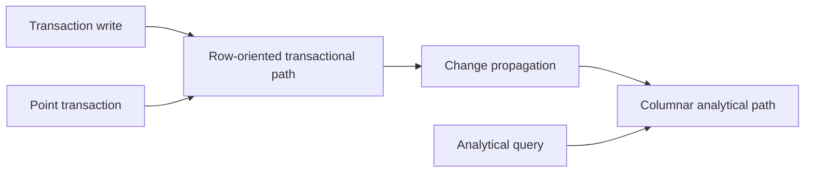

🗓️ 17102026 2135

# htap

Hybrid transactional and analytical processing (HTAP) systems support transactional and analytical workloads in one coordinated data platform.

“One platform” does not always mean one physical representation or one execution engine. Common designs combine row and column stores, replicate operational data into an analytical engine, or use separate compute paths over shared storage. The system must keep those views sufficiently fresh and coordinate resource use so analytical scans do not overwhelm latency-sensitive transactions.

HTAP can reduce the delay and pipeline complexity between operational writes and analysis. It does not remove the need for data modeling, workload isolation, or consistency decisions, and it does not guarantee that every query runs on the freshest data.

When evaluating a system, ask how changes reach the analytical path, what freshness and consistency it guarantees, how the optimizer selects an engine, and how OLTP and OLAP workloads share resources.

For transactional workload properties, see [[oltp]]. For analytical workload properties, see [[olap]]. For sharing and separating resources, see [[storage_computing_architectures]].

## References

- [TiDB: A Raft-based HTAP Database](https://vldb.org/pvldb/vol13/p3072-huang.pdf)
