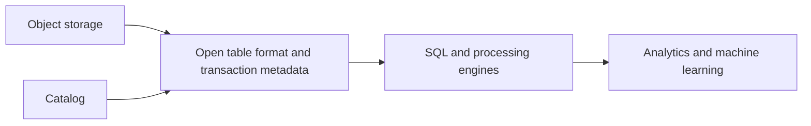

🗓️ 06032025 1756

# lakehouse

A **lakehouse** combines data-lake storage with table features used by analytical systems. The term describes an architecture; its guarantees depend on the table format and query engines.

## What the architecture combines

- Lake-style storage for diverse data and open file formats.
- Table-level metadata and transactions through formats such as [[delta_lake]].
- Analytical query engines that can share data without copying it into a separate warehouse.
- Governance, schema, and workload controls supplied by the surrounding platform.

## Trade-offs

Open storage can reduce duplication and support multiple engines. Teams still need to manage file layout, metadata, access controls, compaction, and compatibility between writers and readers.

Compare [[lakes]] and [[warehouses]] to see which properties the lakehouse approach combines.

## References

- [Delta Lake documentation](https://docs.delta.io/)
- [Databricks: What is a data lakehouse?](https://www.databricks.com/glossary/data-lakehouse)
