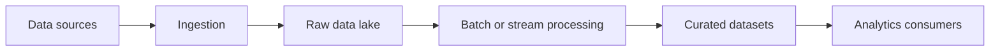

🗓️ 06032025 1753

# lakes

A **data lake** stores data in its source form or in lightly processed form, often on distributed file or object storage. Compute engines read and transform the data when needed.

## Strengths

- Stores structured, semi-structured, and unstructured data.
- Separates storage from the engines that process it.
- Supports batch and streaming workloads when the surrounding tools provide them.

## Costs

- Raw files alone do not provide table transactions or consistent schema enforcement.
- Poor partitioning and many small files can slow queries.
- Teams must add catalog, governance, quality, and retention practices.

Table formats such as [[delta_lake]] add table-level behavior. A [[lakehouse]] combines these features with analytical workloads.

## References

- [Delta Lake documentation](https://docs.delta.io/)
