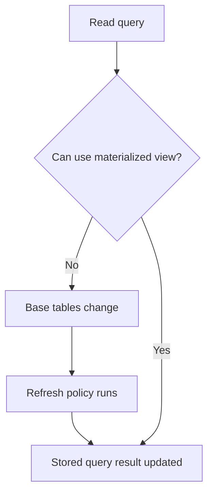

🗓️ 03022025 1601

# materialized_view

A **materialized view** stores the result of a query so later reads can avoid recomputing it. The stored result can become stale until the database refreshes it.



## When it helps

- Reuse an expensive aggregation for dashboards or reports.
- Trade freshness and refresh cost for faster reads.
- Precompute results used by many queries.

## Design questions

- How stale may the result be?
- Does the database refresh it on demand, on a schedule, or incrementally?
- Can refresh work block readers or writers?
- Does the saved query fit available indexes and storage?

```sql
CREATE MATERIALIZED VIEW daily_sales AS
SELECT sale_date, SUM(amount) AS total
FROM sales
GROUP BY sale_date;
```

Refresh syntax and behavior vary by database. Compare with a regular [[view]], which evaluates its query when read.

## References

- [PostgreSQL: CREATE MATERIALIZED VIEW](https://www.postgresql.org/docs/current/sql-creatematerializedview.html)
