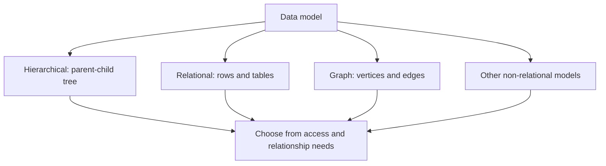

🗓️ 22012025 2344

# model_types

## Hierarchical Model

> Represents data as one big tree.

- **Use Case:** Organizational charts, file systems.
- **Strengths:**
    - Simple to understand and implement
    - Effective for strictly hierarchical data
- **Weaknesses:**
    - Poor at handling **many-to-many** relationships
    - Changes to hierarchy require schema changes.
- **Example:** IBM IMS, Windows Registry.

## Relational Model

> Based on a structured schema of tables, designed to address the limitations of the hierarchical model
- **Use Case:** E-commerce platforms, banking systems.
- **Strengths:**
    - Flexible and widely used.
    - Strong support for data integrity and constraints.
- **Weaknesses:**
    - Struggles with unstructured data.
    - Joins can be a bottleneck in large datasets.
- **Example:** PostgreSQL, MySQL, Oracle.

## Non-Relational Models

### Document Model

- **Description:** Data is stored as self-contained documents (e.g., JSON, BSON).
- **Use Case:** Product catalogs, content management systems.
- **Strengths:**
    - Great for unstructured/semi-structured data.
    - Scales well horizontally.
- **Weaknesses:**
    - Relationships between documents are harder to enforce.
- **Example:** MongoDB, Couchbase.

### Graph Model

> Designed for highly connected data with complex relationships (nodes and edges)

- **Use Case:** Social networks, recommendation systems, fraud detection.
- **Strengths:**
    - Efficient for traversing relationships.
    - Intuitive for graph-like data.
- **Weaknesses:**
    - Less mature and standardized than relational databases.
- **Example:** Neo4j, JanusGraph.

## **Transition to Non-Relational Models**

- **Why Non-Relational Models Emerged:**
    - Big data and distributed systems require better horizontal scalability.
    - Increasing need to handle semi-structured and unstructured data.
---

## References
- DDIA Chapter 2
