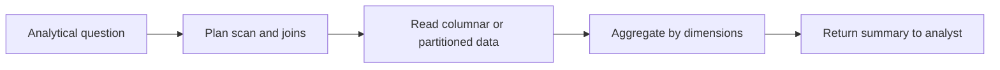

🗓️ 01112024 2245

# olap

**Online analytical processing (OLAP)** runs queries that scan, join, and aggregate large datasets to answer analytical questions. It often serves analysts and reporting systems, while [[oltp]] serves application transactions.

## Access pattern

- A query may read many rows but return a small result.
- Disk or object-store throughput, data layout, and query planning can dominate runtime.
- Workloads range from scheduled reports to interactive exploration.

## How an OLAP query runs

1. Data arrives from operational systems, files, or event streams.
2. An ingestion process validates and prepares it for analysis.
3. A query engine scans relevant data, applies filters, joins, and aggregates.
4. Results feed reports, dashboards, or further analysis.

Columnar storage and [[star_schema]] or [[snowflake_schema]] models can help common analytical access patterns. They are design choices, not requirements for all OLAP systems.

## Common implementation styles

MOLAP, ROLAP, and HOLAP describe classic multidimensional analysis approaches. Modern systems may combine them; use these terms as broad patterns.

### MOLAP

A multidimensional engine stores precomputed aggregates in a cube. Reads can be fast for covered dimensions, while refresh and cube size add cost.

### ROLAP

A relational engine answers analytical queries over relational tables. It can handle detailed data, with performance shaped by layout, indexes, query plans, and compute capacity.

### HOLAP

A hybrid approach combines precomputed cube results with relational detail. It can balance common fast queries with access to detailed records, at the cost of maintaining both paths.

## References

- [AWS: What is OLAP?](https://aws.amazon.com/what-is/olap/)
- oltp
- [[oltp_vs_olap]]
