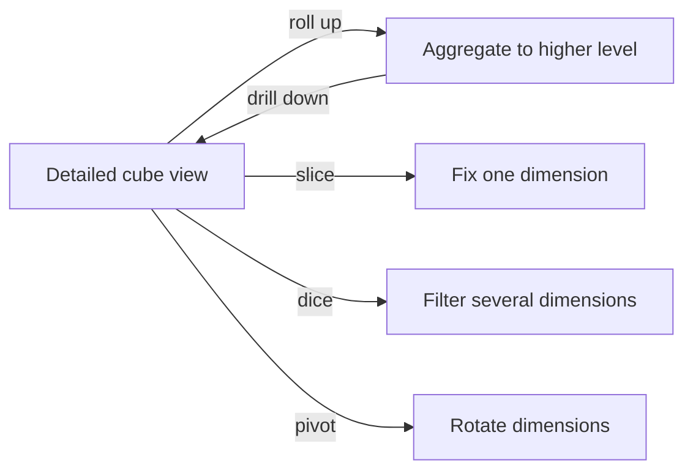

🗓️ 02112024 1230

# olap_operations

OLAP operations change the level or orientation of an analytical view. They may apply to cubes or other multidimensional models.

## Roll up

Aggregate data to a higher level in a dimension hierarchy, such as combining monthly sales into annual totals.

## Drill down

Move to a more detailed level, such as opening annual sales into quarters and months.

## Slice

Fix one dimension value and view the remaining dimensions. Selecting one month from a product-city-month cube leaves a product-by-city view.

## Dice

Filter on multiple dimensions to create a smaller subcube, such as two cities across three months.

## Pivot

Reorient dimensions in a report to compare the same values from another perspective. Pivoting changes presentation, not the underlying facts.

## References

- [AWS: What is OLAP?](https://aws.amazon.com/what-is/olap/)
- [[olap]]
