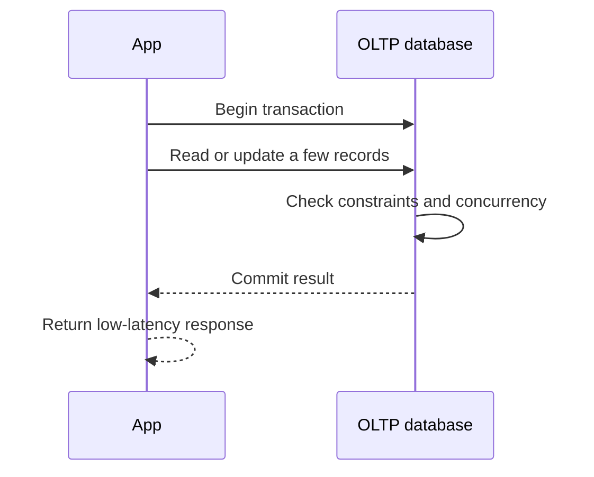

🗓️ 01112024 2102

# oltp

**Online transaction processing (OLTP)** serves application operations that read or change a small amount of data per request. It prioritizes correct concurrent updates and predictable response time.

## Terms

| Term | Definition | Source |
|---|---|---|
| **Transaction** | A unit of database work that commits or aborts as a whole, subject to the database's transaction guarantees. | [Oracle: What is OLTP?](https://www.oracle.com/sg/database/what-is-oltp/) |

## Access pattern

An order service may read one account row, check inventory, and write a few records in a transaction. Indexes help locate those records without scanning an entire table.

## Design priorities

- Keep transactions short and limit lock contention.
- Preserve correctness under concurrent requests.
- Choose indexes for the application's read and write patterns.
- Plan for recovery, availability, security, and growth.

Latency and throughput targets depend on the workload and system; there is no universal response-time figure. Compare with [[olap]] and [[oltp_vs_olap]].

## References

- [Oracle: What is OLTP?](https://www.oracle.com/sg/database/what-is-oltp/)
- [[ACID]]
