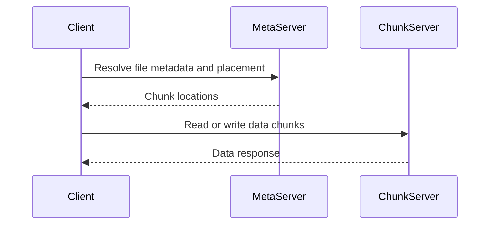

🗓️ 17102026 2135

# pangu

Pangu is Alibaba's distributed storage system; the cited architecture overview describes Pangu 2.0 as a shared storage foundation for multiple cloud products and workloads.

## Mental model

The architecture article describes three core roles:

- **Client:** coordinates I/O and consults metadata when needed.
- **MetaServer:** manages filesystem metadata and placement.
- **ChunkServer:** stores and serves data chunks.

Product-specific access layers connect applications to the core, including block, log-oriented, and HDFS-compatible interfaces. This layered design separates product semantics from the storage engine and lets different workloads share storage infrastructure.

## Design choices described in the source

The article presents distributed metadata partitions, replicated metadata, client-coordinated data I/O, and heterogeneous storage media as design choices for scaling, availability, performance, and cost. These are architecture claims from the referenced article; implementation details and product guarantees may have changed since publication.

The useful systems lesson is to separate metadata coordination from bulk data transfer, partition metadata to limit failure scope, and add compatibility layers at the product boundary. Each choice introduces tradeoffs in consistency, operational complexity, and workload isolation.

For storage and compute deployed separately, see [[storage_disaggregation_architecture]]. For compute-layer responsibilities, see [[compute_platform]]. For coupling and separation tradeoffs, see [[storage_computing_architectures]].

## References

- [Alibaba Cloud: Pangu, the high-performance distributed file system](https://www.alibabacloud.com/blog/pangu-the-high-performance-distributed-file-system-by-alibaba-cloud_594059)
