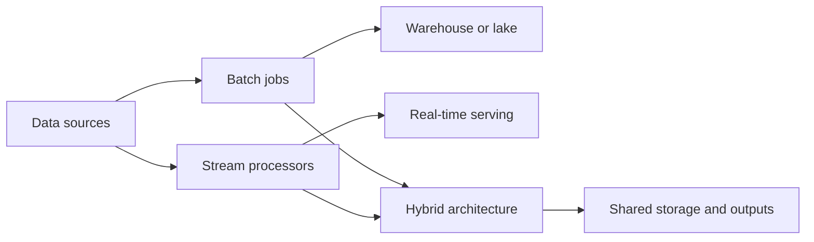

🗓️ 07032025 1550

# processing_architectures

A data-processing architecture defines when data is processed, where intermediate results live, and how outputs reach consumers. The workload's freshness, replay, and cost requirements determine the design.

## Batch processing

Process a bounded dataset on a schedule or when a job is submitted. Batch work suits backfills and reports where completion latency is acceptable. [[extract_transform_load]] describes a common batch pipeline.

## Stream processing

Process events continuously as they arrive. This lowers result latency, but requires decisions about ordering, late events, state, and recovery. See [[stream_processing_fundamentals]] and [[kafka_architecture]].

## Hybrid processing

Some systems combine scheduled historical computation with continuous updates. Lambda and Kappa are named design approaches for this problem; their trade-offs depend on whether the system maintains separate batch and stream paths or one replayable stream path.

## Storage choices

Data lakes, warehouses, and lakehouses describe storage and access architectures. They can support batch or streaming; they are not processing modes by themselves. See [[lakes]], [[warehouses]], and [[lakehouse]].

## References

- extract transform load
- stream processing fundamentals
- kafka architecture
