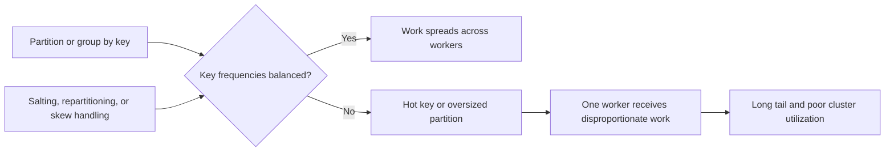

🗓️ 03022025 1215

# skew

**Data skew issues** occur when data is unevenly distributed across segments (shards) in a distributed database system

## Causes
- **Uneven Distribution**: If the distribution key (the column used to partition data across segments) is not chosen carefully, some segments may end up with significantly more data than others.

- **Hotspots**: Certain values in the distribution key column may appear much more frequently than others, causing those segments to become overloaded.

## Problems

1. **Performance Bottlenecks**:
    - Overloaded segments (with more data) take longer to process, slowing down queries that depend on them.
    - Other segments may sit idle, wasting computational resources.
2. **Resource Imbalance**:
    - Skewed data distribution can lead to uneven usage of CPU, memory, and disk I/O, reducing the overall efficiency of the system.
3. **Scalability Issues**:
    - As data grows, skewed segments can become even more overloaded, making it harder to scale the system effectively.

---
## References
- [Hologres: Best practices for table properties](https://www.alibabacloud.com/help/en/hologres/user-guide/guide-on-scenario-specific-table-creation-and-tuning)
