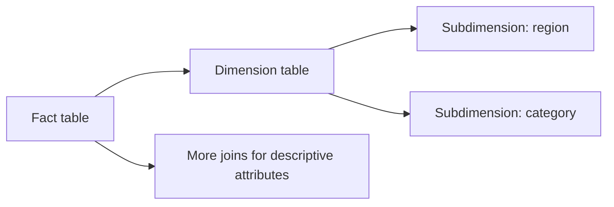

🗓️ 17102026 2135

# snowflake_schema

A snowflake schema normalizes some dimensions into related subdimension tables.



## How it works

In a [[star_schema]], each dimension is usually represented by one denormalized table joined directly to the fact table. A snowflake schema splits selected dimensions into additional tables. For example, a product dimension may reference a product-type dimension, which may reference a category dimension.

Queries then join through that dimension hierarchy. This can reduce repeated descriptive data, but it adds joins and makes the model less direct for analysts. It is a modeling choice, not a feature required by a warehouse product.

## Example

```text
sales_fact -> product_dimension -> product_type_dimension
```

Use this shape when the normalization benefit is useful and the extra joins are acceptable. Keep frequently queried reporting dimensions denormalized when simpler queries matter more.

For analytical storage context, see [[warehouses]].

## References

- [AWS: What is OLAP?](https://aws.amazon.com/what-is/olap/)
