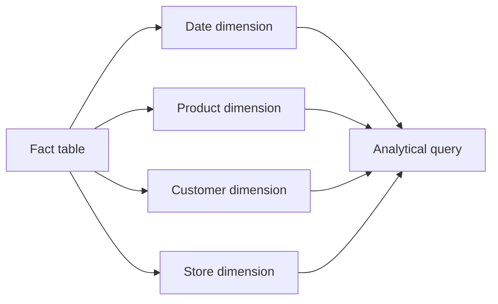

🗓️ 02112024 1153

# star_schema

```ad-info
[[olap]] data model
```

| Components               | Description                                                                 |
| ------------------------ | --------------------------------------------------------------------------- |
| `Fact Table`             | **Data table** that contains numerical values related to a business process |
| `Multi dimension tables` | Values that **describe each attribute** in a fact table                     |
>  The fact table refers to **dimensional tables** with foreign keys—unique identifiers that correlate to the respective information in the dimension table

```ad-info
A fact table connects to several dimension tables so the data model looks like a star
```



## Example

> Example of a fact table for product sales

**Fact table** for product sales:
- Product ID
- Location ID
- Salesperson ID
- Sales amount

**Product Dimension Table**
- Product ID
- Product name
- Product type
- Product cost

**Location Dimension Table**
- Location ID
- Country
- City

**Salesperson table**
- Salesperson ID
- First name
- Last name
- Email

---

## References
- https://aws.amazon.com/what-is/olap/
