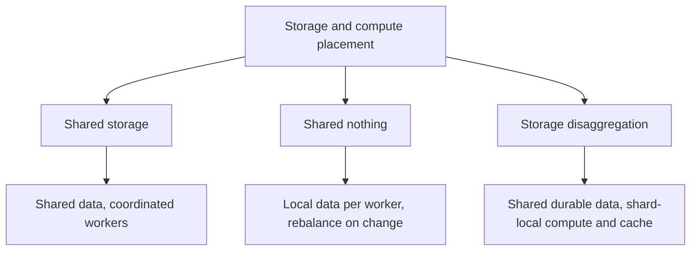

🗓️ 31012025 1652

# storage_computing_architectures

Storage and compute architectures differ in where data lives and how nodes coordinate. Those choices affect scaling, recovery, and data movement.

```ad-abstract
Traditional storage-computing architectures
```




## Shared Disk or Shared Storage

- **How it works:** Worker nodes access common storage.
- **Benefit:** Compute nodes can be replaced without moving their local data.
- **Cost:** Coordination and shared-storage throughput can limit scaling.

## Shared Nothing

- **How it works:** Each worker owns compute and storage; workers exchange data to process distributed queries.
- **Benefit:** Nodes can process local data with limited shared coordination.
- **Cost:** Compute and capacity scale together. Rebalancing data during failures or resizes can take time.

## Choosing an architecture

Choose shared storage when independent compute scaling and simpler data access matter. Choose shared-nothing when local processing and horizontal scale matter. Implementations vary; compare their coordination, network, and recovery paths before applying these general trade-offs.

## [[storage_disaggregation_architecture]]

---

## References
- https://www.alibabacloud.com/help/en/hologres/product-overview/architecture
