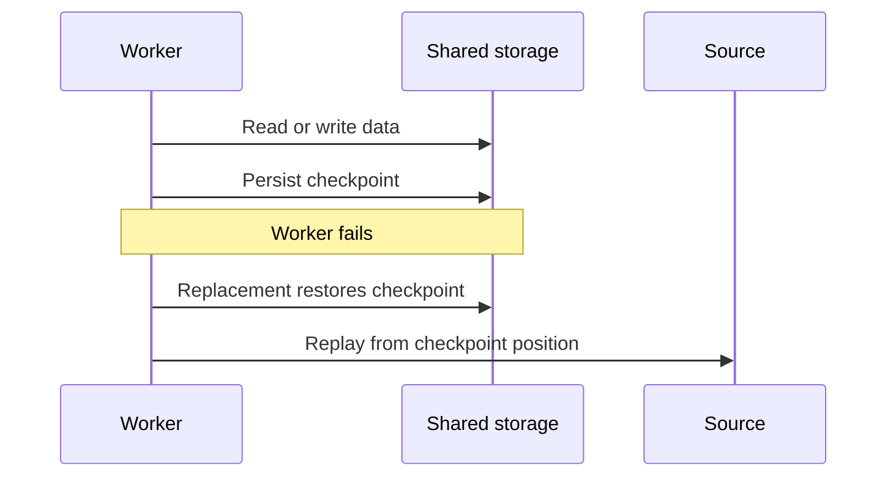

🗓️ 31012025 1657

# storage_disaggregation_architecture

**Storage disaggregation** separates compute resources from persistent storage so they can scale and fail independently. The design shifts data access onto a network path, so storage latency, bandwidth, and recovery behavior become central.

## Request and recovery path

1. Compute workers read input or state from a shared storage service.
2. Workers process data and write outputs or checkpoints to that service.
3. A failed worker can be replaced and recover from durable data or a checkpoint.

The system must still coordinate ownership, consistency, and concurrent access. A shared store alone does not make processing fault-tolerant; the application or engine needs a recovery protocol.

## Trade-offs

- **Independent scaling:** increase compute without copying every stored dataset to new workers.
- **Resource efficiency:** scale compute down when idle while retaining data.
- **Network dependence:** remote reads add latency and can compete for bandwidth.
- **Shared bottlenecks:** storage throughput and metadata services can limit all workers.
- **Recovery cost:** restoring large working state can take time even when data is durable.

This pattern suits variable workloads and systems that can recover from shared storage. A tightly coupled design can be simpler when local data access dominates and compute demand is steady. Compare [[storage_computing_architectures]] and [[compute_platform]].

## Streaming example

A stateful stream processor may keep working state near its tasks and persist checkpoints to durable storage. Recovery restores a checkpoint and replays input from the matching source position. See [[../streaming/flink/checkpointing]] and [[../streaming/flink/state]].

## References

- [Apache Flink: Stateful stream processing](https://nightlies.apache.org/flink/flink-docs-release-1.20/docs/concepts/stateful-stream-processing/)
