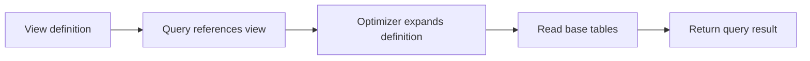

🗓️ 03022025 1559

# view

A **view** is a named query exposed as a table-like object. A regular view stores its query definition; the database evaluates that query when a user reads the view.



## Why use a view

- Give a complex query a stable, reusable name.
- Expose selected rows or columns to limit access to underlying tables.
- Present data in a shape that suits reports or applications.

```sql
CREATE VIEW active_users AS
SELECT id, name
FROM users
WHERE status = 'active';
```

This view returns active users when queried. It does not itself store a snapshot of those rows. A [[materialized_view]] stores results and needs a refresh strategy.

## References

- [PostgreSQL: CREATE VIEW](https://www.postgresql.org/docs/current/sql-createview.html)
